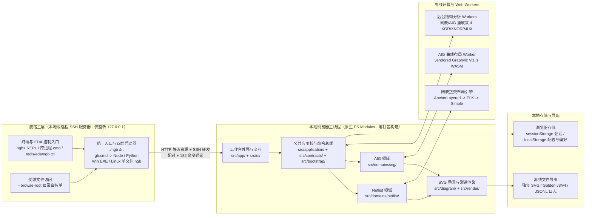
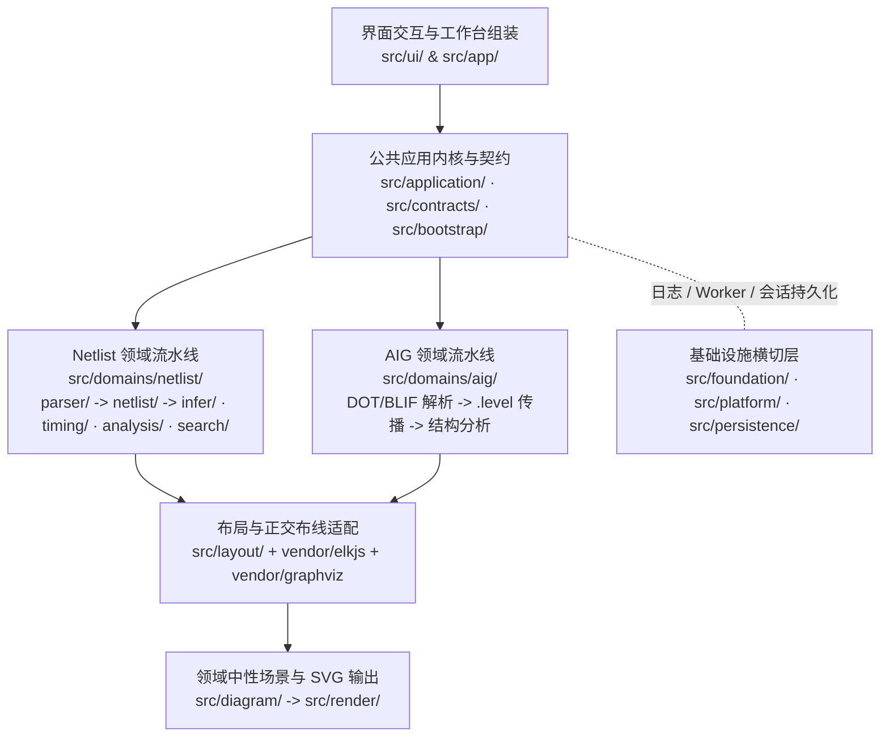

# Netlist Graph Builder 项目介绍（面向研发与 EDA 开发人员）

> **一句话定位**：**Netlist Graph Builder（v1.7.1）** 是一款 **100% 离线、零构建、零外部运行时依赖** 的门级结构化 Verilog 原理图与 AIG 逻辑分析工作台。无需商业 EDA GUI 或 `.lib` 库即可解析网表与 AIG、交互式追踪局部逻辑锥、标注 STA 时序与逻辑层级、并排对比双模块结构，并支持通过 SSH 端口转发与 `ngb.tcl` 从远程服务器驱动多个浏览器页面。

---

## 1. 项目背景与演进脉络

### 1.1 为什么做这个工具（核心痛点）

在综合（Synthesis）、重综合（Resyn）、ECO 与前端逻辑优化的日常开发和排查中，工程师常遇到三类效率瓶颈：

1. **商业工具重且受限**：打开大型 GUI 启动慢、占资源，且常受 License 数量与远程桌面（X11/VNC）带宽限制；临时看一小段综合后网表或 BLIF/DOT 成本过高。
2. **传统开源工具偏静态**：多数脚本生成的 DOT/SVG 是静态整图，缺乏交互式放大定位、多根节点局部聚焦（`Focused`）、跨层次实例钻取以及高扇出线网控制；没有 `.lib` 时往往无法分辨门类型和引脚方向。
3. **跨环境与对比分析割裂**：源码在远程 Linux 服务器跑流程、人在本地看图，来回拷文件麻烦；优化前后的两个模块或同一设计的多份 AIG 缺少开箱即用的并排结构差异视图与路径级数计算。

### 1.2 项目演进脉络

项目从单一的门级网表小工具逐步演进为多领域工作台：

1. **Phase 1 · 离线门级 Verilog 原理图浏览器**：以零构建原生 ES Modules 起步，实现无 `.lib` 引脚/门类推断、大模块 `Search-first`、`Focused` 逻辑锥、双模块 `Compare` 与 `Adjust` / Golden 快照。
2. **Phase 2 · 布局与工程化升级**：自研 `AnchorLayered` 物理锚点正交布局替代传统引擎作为默认方案（在 47 个真实映射网表上达到 **47/47 零硬违规**）；引入工业级 NGB Timing v1.0、可选 `.lib` 库以及指定 Net 不布线。
3. **Phase 3 · 多领域工作台演进**：抽离 `contracts/` 与 `application/` 公共内核，在不侵入网表流水线的前提下接入独立 **AIG 工作区**（离线 Graphviz/WASM、重收敛与 XOR/XNOR/MUX 识别）及跨领域 `Show Path`。
4. **Phase 4 · 远程协作与 EDA 生态闭环**：打通 SSH 端口转发、`File → Open from server…`、四端共享 **182 条命令** 与 `tools/eda/ngb.tcl`，并支持同页多份 AIG 与 `.level` 层级裕量报告。

### 1.3 为什么这样设计（关键取舍）

- **胖前端 + 原生 ES Modules**：解析、推断、布局、渲染全部在本地浏览器运行，打开即用、不依赖服务器算力，也不引入 Webpack/Vite 等构建链，源码与 Windows/Linux 发布包运行同一套原生 JS 模块。
- **瘦宿主启动器（Thin Launcher）**：Node.js、Python 3、Windows EXE 与 Linux 单文件 `ngb` 只承担静态资源服务（仅监听 `127.0.0.1`）、受限服务器目录访问与终端/Tcl 命令中继，不直接参与图形重渲染。
- **严格单向分层**：`parser` 与渲染彻底解耦，领域模型与公共外壳通过契约通信，确保新增 AIG、Timing 或远程控制能力时不会破坏已有网表主链路。

---

## 2. 项目基本情况一览

| 维度 | 当前现状（`v1.7.1`） |
| --- | --- |
| **核心能力域** | **Netlist 工作区**（门级结构化 Verilog）+ **AIG 工作区**（ABC AIG `.dot` / 平坦两输入组合 `.blif` + `.level`） |
| **前端技术形态** | 浏览器原生 ES Modules + HTML/CSS + 交互式 SVG，无打包构建步骤（No bundler），零 npm 运行时依赖 |
| **离线内置引擎** | 网表自研 `AnchorLayered`（默认）→ `ELK (vendored elkjs 0.11.1)` → `Simple`；AIG 本地化 `Graphviz (Viz.js / WASM)` |
| **运行与分发方式** | 通用源码单入口（`./ngb` / `.\ngb.cmd`）+ 四端共享 CLI 参数与 **182 条工作台命令（+5 简写）**：Node.js、Python 3、Windows 离线 EXE、Linux 单文件 ELF (`ngb`) |
| **远程与 EDA 集成** | SSH 端口转发配对、`File → Open from server…`、终端交互 REPL（`ngb>`）、跨进程 `cmd`、EDA Tcl 封装 `tools/eda/ngb.tcl` |
| **质量与验证规模** | 1,570+ 单元测试、Acorn AST 架构边界门禁、47/47 映射网表硬约束零违规、三端远程协议及浏览器 E2E 回归 |
| **运行安全边界** | 100% 离线运行；HTTP 服务仅绑定 `127.0.0.1`；输入转义防 XSS；日志自动脱敏不落盘网表原文 |

---

## 3. 快速启动与运行方式

### 3.1 通用单入口与多种启动方式

- **通用源码单入口（推荐，无需 npm 或第三方包）**：自动探测 **Node.js 18+**，不可用时自动探测 **Python 3.6+**，无需 `npm start --` 分隔符，相对路径保持相对于**调用时的工作目录**（详见 [通用源码启动入口](UNIVERSAL_LAUNCHER.md)）：
  ```bash
  # Linux / macOS：
  ./ngb --no-open --port 4173 --browse-root /work/run
  # 自动化脚本可通过 NGB_RUNTIME=auto|node|python 固定运行时：
  NGB_RUNTIME=python ./ngb start --state-file ./ngb.state --no-open
  ```
  ```powershell
  # Windows PowerShell / CMD：
  .\ngb.cmd --no-open --port 4173
  ```
- **直接指定后端（Node.js 18+ / Python 3）**：
  ```bash
  npm start
  node tools/serve.mjs --port 4210 --no-open
  python3 -u tools/serve.py --port 0 --no-open
  ```
- **VS Code 一键预览**：按 `Ctrl+Shift+D` 选择 `Netlist Graph Builder: Open View`，按 `F5` 自动启动本地/Remote-SSH 服务并在 Integrated Browser 中打开（`tools/start-preview.sh` 转发至通用入口 `./ngb`）。
- **离线发行包**：
  - **Windows 离线包**：完整解压后双击 `NetlistGraphBuilder.exe`（内置 CPython 运行时与全部资源）。
  - **Linux 单文件 ELF**：赋予执行权限后 `./ngb start`（CMake 构建，内嵌全部前端、ELK、Graphviz/WASM 与许可证，详见 [Linux 单文件启动器指南](LINUX_SINGLE_FILE_LAUNCHER.md)）。

### 3.2 内置示例文件（开箱即试）

| 示例文件 | 适用演示场景 |
| --- | --- |
| [`examples/two_equivalent_style_modules.v`](../examples/two_equivalent_style_modules.v) | 基础双模块对比（Resyn / Flex） |
| [`examples/hierarchical_escaped_compare.v`](../examples/hierarchical_escaped_compare.v) + [`.txt`](../examples/hierarchical_escaped_timing.txt) | 含转义层次名的双模块对比 + 多模块标准 STA 时序报告 |
| [`examples/module_hierarchy_demo.v`](../examples/module_hierarchy_demo.v) | 多级子模块例化（`hinst`）双击钻取与跨父层边界追踪 |
| [`examples/large_buffer_chain_1024.v`](../examples/large_buffer_chain_1024.v) | 1024 级缓冲器长链大图与 `Search-first` / `Focused` 体验 |
| [`examples/aig_structure_demo.blif`](../examples/aig_structure_demo.blif) | AIG 重汇聚（6 对）与 XOR2 / XNOR2 / MUX2（3 块）结构分析 |
| [`examples/aig_mapped_names.blif`](../examples/aig_mapped_names.blif) + [`.level`](../examples/aig_mapped_names.level) | BLIF 注释名称映射 + `.level` 拓扑层级传播与 AT/RT/Slack 报告 |

---

## 4. 核心功能与使用方法

### 4.1 导入、识别与界面基础操作

- **多种导入方式**：
  - `File → Open design…` 支持单选主文件或**同时勾选主文件与附件**（如 Verilog + Timing 或 AIG + Level）；`Netlist + Timing` 与 `AIG + Level` 分组支持 `Add design/timing/AIG file(s)…` 追加合并（不同文件同名模块自动以 `<模块名> [<文件名>]` 区分）以及大文本预览优化的 `Paste …` 对话框。
  - 页面任意位置支持**文件拖放**与非输入框焦点下的 **`Ctrl+V` 全局粘贴**，自动按依赖顺序编排（Netlist 批次：`Liberty → 网表 → Timing → Golden`；AIG 批次自动按同名主干配对 `.level`）。
- **无 `.lib` 智能推断 + 可选 `.lib` + `Cell Config`**：
  - 默认无需 `.lib` 即可根据命名规则推断门类型与引脚方向，未识别原语保守显示为 `BLACKBOX`；支持解析 Verilog 结构化注释属性（`// module: ...`）。
  - `Settings → Liberty` 可离线加载/替换/卸载文本 `.lib`（上限 64 MiB），方向优先级严格遵循：**单实例 `Adjust` > `Cell Config` > `.lib` > 内置规则**。
  - 选中黑盒单元点击 Inspector 底部 `Edit cell type…` 可按 `cell type` 定义门类型与引脚方向并保存在 `localStorage`（支持 JSON 导入导出与 `--cell-config` 启动传入）。
- **面板空间与常用快捷键**：
  - 点击左右面板 `Hide` 或顶部 `Navigator` / `Inspector` 可随时收起/恢复面板（保持视口中心与缩放倍率，不重排布局）。
  - `/` 聚焦全局搜索、`F` 居中放大选中对象、`Ctrl+Z` / `Ctrl+Shift+Z`（或 `Alt+←/→`）在统一视图历史间前进/后退、`Esc` 关闭菜单或抽屉。

### 4.2 大图浏览、局部聚焦与手工校准（Netlist）

- **大图 `Search-first`（> 500 单元）**：打开大型模块时默认先建立全量索引而不做耗时整图布局；通过顶部 `Search` 检索 `Module / Port / Net / Cell instance / Cell type`，点击或按 `Enter` 激活后立即以目标为中心展开 `Focused` 局部图。
- **多根 `Focused` 局部锥（最多 32 个 roots）**：
  - `Fanin` / `Fanout` 深度可在 `0–99` 独立调节（`0` 关闭该方向扩展）；画布上方 `Roots` 菜单支持筛选、点击居中、单个移除与清空；Inspector 提供 `Add to Focused` 与 `Replace roots`。
- **层次导航与跨层追踪**：
  - `Navigator → Hierarchy` 浏览实例树（有界展开最多 2000 节点 / 64 层）；画布上**双击真实子模块实例（`hinst`）** 直接钻取进入。
  - `Inspector → Connections` 严格区分 `Current module` 与 `Hierarchy / Parent occurrence`（跨边界父层连接），点击即可逐跳连续追踪；`Inspector → Attributes` 展示注释属性与推断来源；`Navigator → Analysis` 分析当前可见组合逻辑中的重收敛路径。
- **可读性控制、不布线 Net 与手工校准**：
  - `Settings → Display` 支持切换 `Show aliases`、`Fanout hubs`（扇出 `≥ 8`）以及 `Gate symbols`（`Rectangles` 矩形框 ↔ `Conventional` 标准门符号，不改变几何尺寸与布线）。
  - 选中 `clk` / `reset` 等高扇出线网后在 `Inspector → Connections → Net routing` 取消勾选 `Route net`，可隐藏其几何走线而保留完整连接与追踪能力。
  - 开启上下文栏 `Adjust` 可直接拖拽节点（释放后仅局部重布线）或在 `Inspector → Adjust` 覆盖单实例尺寸/属性/引脚方向；通过 `File → Save Golden` / `Load Golden…`（v3/v4 带内容指纹校验）保存和复原。

### 4.3 Timing 时序标注与 Compare 双模块对比

- **NGB Timing Format v1.0**：支持列式文本（空格/Tab/CSV，简单 4 列 `point at rt slack` 与详细模式 `delay / slew / edge / kind`）及结构化 JSON；线网 `point` 自动沿 `assign` 别名链回溯至驱动源。
- **显示策略与漏配诊断**：`Settings → Timing` 提供 `Metric`（`Worst Slack / AT / RT / Delay / Slew / All / None`）与 `Threshold`（默认 `0.0`，`slack < threshold` 标红）；严格隔离多文件、多级 occurrence 与 `LocalDesign` 作用域；选中缺时序单元可在 `Inspector → Timing` 查看未匹配原因及候选路径并写入 `Log`。
- **Compare 双模块对比**：点击顶栏 `Compare`，支持 `A files` / `B files` 为左右（或上下 `Split`）两侧独立加载网表与专属时序；`Sync & cone` 提供 `Sync pan / zoom`、`Center match on click`、`Sync Focus roots` 以及同名输出端口 `Output cone` 同步比对；画布使用启发式结构提示着色（绿实线=建立基础对应，红虚线=单侧未匹配，橙=当前选中）。

### 4.4 跨领域 `Show Path` 路径与逻辑级数

- 同时适用于 **Netlist（Single 与 Compare A/B）** 与 **AIG**，入口为上下文栏 `Show Path` 或 `Navigator → Path`。
- 可分别指定最多 `32` 个 `Starts` 与 `32` 个 `Ends`（留空一端可查自动边界 `Auto starts` / `Auto ends`）；点击 `Apply` 在画布显示路径并集，并在 `Path information` 列出 `To selected end`、`From start` 与 `Object levels` 的最短/最长逻辑级数。
- 可与 `Focused` 联动裁剪（画面外端点在报告中保留为 `outside Focused`）；支持 Golden v4 持久化以及在 Compare 模式下分别导出 A 侧或 B 侧带查询摘要的独立 SVG。

### 4.5 独立 AIG 逻辑分析工作区

- **导入与多图管理**：支持 ABC AIG `.dot` 与平坦两输入组合 `.blif`；支持同一页面追加并切换最多 `64` 份 AIG（顶栏 `Active AIG graph`）；大图可先勾选 `Open AIG in Search-first` 建索引再按 `Focused` / `Show Path` 布局。
- **`.level` 层级与裕量报告**：支持两列 PI 初始 `at_level` 简写向下游传播拓扑层级，以及带表头的 `point at_level rt_level slack_level` 报告；各图独立保存 Level 附件。
- **视图与分析**：默认 `Logic View`（可切换 `Standard` 分层）；`Highlight connections` 支持按 `All` / `Off` / `N levels` 追踪上下游；`Settings → AIG overlays` 提供 `Block labels`、`Dim outside selected result`、`Logical critical path`、`High fanout`；`Navigator → Analysis` 与 `Inspector → Analysis` 提供结构重收敛（蓝/橙见证路径 + 青色并集）及 **XOR2 / XNOR2 / MUX2** 逻辑块识别与点相关查询。

### 4.6 SSH 远程工作台与 EDA/Tcl 集成

- **SSH 端口转发**：服务器执行 `./ngb --no-open --browse-root /work/run`（或 `npm start -- --no-open` / Linux 单文件 `ngb start`），本地转发端口后用终端打印的 `pairUrl` 打开浏览器，即可通过 `File → Open from server…` 直接选择服务器文件。
- **多页终端与脚本控制**：同一后端支持多个浏览器标签页（`pages` 查看、`use p1` 选中）；交互式 `ngb>`、独立 CLI `ngb cmd --state-file ...` 与 `tools/eda/ngb.tcl`（`::ngb::Start / Status / Stop / Connect / Cmd`）共用 **182 条命令与 5 个简写**（支持 `--async` 与 `job wait`）。

---

## 5. 整体架构与实现原理（附架构图）

这部分面向开发同事快速建立“项目怎么跑起来、代码怎么组织”的心智模型，详细模块契约见 [`ARCHITECTURE.md`](ARCHITECTURE.md)。

### 5.1 系统整体运行与部署架构



### 5.2 前端代码分层与单向数据流

代码遵循“**左侧只读右侧产物，上层不跨层直连底层私有细节**”的单向数据流：



- **AST 级静态门禁**：`npm run test:architecture` 借助离线 Acorn 解析 `src/` 下全部模块依赖图，自动拦截逆向依赖与循环引用；除 `parser/` 外，后续层禁止直接读取 Verilog 源码原文。

### 5.3 核心目录速查（看代码从哪找）

| 目录 | 核心职责 |
| --- | --- |
| `src/app/` & `src/ui/` | 浏览器入口组装、工作台外壳、面板/画布/弹窗/手势控制器 |
| `src/application/` & `src/contracts/` & `src/bootstrap/` | 多领域文档/会话状态机、命令总线、异步任务协调与领域注册 |
| `src/domains/netlist/` & `src/domains/aig/` | Netlist 与 AIG 各自独立的投影、查询、分析与用例实现 |
| `src/parser/` `netlist/` `infer/` `timing/` `analysis/` `search/` | 结构化解析、IR 模型、无库/Liberty 推断、STA 时序、重收敛与搜索索引 |
| `src/layout/` & `src/diagram/` & `src/render/` | `AnchorLayered` / `ELK` / `Simple` / Graphviz 适配、领域中性显示图与 SVG 渐进渲染 |
| `src/platform/` `persistence/` `foundation/` | Web Worker 包装、session/localStorage/Golden 持久化与基础工具/脱敏日志 |
| `tools/` & `native/` & `vendor/` | 通用单入口 `./ngb`/`ngb.cmd`、Node/Python 服务、Windows/Linux 启动器、`ngb.tcl` 与离线 ELK/Graphviz 引擎 |

### 5.4 关键实现机制（点到为止）

1. **布局引擎与自动降级**：Netlist 默认使用自研 `AnchorLayered`（47 个映射网表 **47/47 零硬违规**），不支持拓扑自动按 `AnchorLayered -> ELK -> Simple` 降级（不覆写用户偏好，`Simple` 保持冻结）；AIG 运行在独立 Graphviz/WASM Worker（20s 布局超时、15s 分析超时隔离保护）。
2. **交互流畅度保障**：缩放/平移/拖拽热路径只更新轻量 DOM 预览与变换矩阵；`Adjust` 释放后仅对受影响边局部重布线；可见节点+边 `≥ 400` 启用可取消渐进渲染，缩放 `< 0.65` 启用 LOD 隐藏细节，扇出 `≥ 8` 自动生成 Hub。
3. **可观测性与测试矩阵**：页面内存 `Process Log`（11 个 Phase、500 条上限、自动脱敏导出 JSONL）+ 终端磁盘 JSONL（~2 MiB 轮转、14 天清理）；测试涵盖 `npm test`（1,570+ 单测 + AST 架构门禁）、`test:docs`、`test:mapped-cases` 与 `test:remote-protocol`。

---

## 6. 能力边界与延伸阅读

**当前明确边界**：

- 不是完整 Verilog / SystemVerilog 行为级仿真或编译器（不支持 `always`、`generate` 展开）。
- `Compare` 提供启发式结构差异提示，不等同于形式化逻辑等价验证（LEC）。
- AIG 工作区暂不支持二进制/ASCII AIGER（`.aig` / `.aag`）、网表转 AIG 或 AIG 双图并排 Compare。

**延伸文档索引**：

- 完整用户手册总目录：[`docs/USER_GUIDE.md`](USER_GUIDE.md)
- 分册指南（01–09）：[01 入门与界面](guide/01-getting-started.md) · [02 导入与库](guide/02-import-and-libraries.md) · [03 网表浏览](guide/03-netlist-navigation-and-views.md) · [04 布局与导出](guide/04-layout-routing-and-adjust.md) · [05 时序与对比](guide/05-timing-and-compare.md) · [06 Show Path](guide/06-show-path.md) · [07 AIG 工作区](guide/07-aig-workspace.md) · [08 SSH 与 EDA](guide/08-remote-workbench-and-eda.md) · [09 日志与排障](guide/09-logging-workflows-and-faq.md)
- 技术与规范文档：[`ARCHITECTURE.md`](ARCHITECTURE.md) · [`UNIVERSAL_LAUNCHER.md`](UNIVERSAL_LAUNCHER.md) · [`LINUX_SINGLE_FILE_LAUNCHER.md`](LINUX_SINGLE_FILE_LAUNCHER.md) · [`timing_format_spec.md`](design/timing_format_spec.md) · [`aig_level_format_spec.md`](design/aig_level_format_spec.md) · [`remote_workbench_commands.md`](plans/remote_workbench_commands.md)
- 配套演示文稿（14 页宽屏）：[`docs/PROJECT_INTRO.pptx`](PROJECT_INTRO.pptx)
