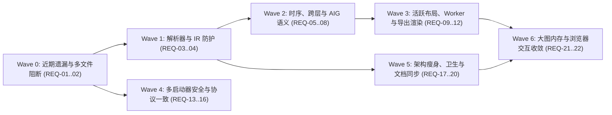

# 项目问题修复方案路线（2026-11-25）

> 对应问题清单：[project_issue_list_2026_11_25.md](../project_issue_list_2026_11_25.md)（基线 `7dc7c6c`）
> 配套文档：[需求拆分文件](./issue_remediation_requirements_2026_11_25.md) · [验收标准文件](./issue_remediation_acceptance_2026_11_25.md)

执行结果、逐项状态与实测数据见[验收记录](./issue_remediation_acceptance_2026_11_25.md#4-本次实测记录)。

## 1. 背景与目标

本路线承接 2026-11-25 对仓库全量的静态代码审查结果（共 55 项已核实问题：`W01`–`W03`、`B01`–`B25`、`S01`–`S10`、`P01`–`P08`、`A01`–`A09`），将问题收敛为 **Wave 0 ~ Wave 6 共 7 个工程波次 / 22 个需求包（`REQ-01`–`REQ-22`）** 与 **1 项明确冻结边界（`A04`）**。

核心目标：
1. **先止血再扩面**：优先收口 `7dc7c6c`（`compare sync-selection`）遗留与多文件视图历史/持久化失效（`B01`），避免最近交付能力继续积累回归。
2. **先保正确性与安全，再追吞吐与卫生**：按数据流方向（`parser/IR` → `timing/domains` → `layout/render`）修复静默丢数据与崩溃缺陷；统一补齐 Node/Python/C++/Tcl 四端启动器安全校验；将高风险的换行符批量归一与架构拆解单独隔离合入。
3. **每波独立可测、可回滚**：每个 Wave 均可独立验证退出，不把未完成的大图性能探索（Wave 6）阻塞前面的正确性与安全交付。

---

## 2. 硬性工程红线（全程不可违背）

1. **Simple 永久冻结与共享边界隔离（[AGENTS.md](../../AGENTS.md)）**
   - 严禁修改、重命名、抽取或搬迁 `src/layout/simple*.js` 及 Simple 专属模块（`channelCapacity.js`、`src/layout/layered/` 等 25 文件，即 `A04`）。
   - 修改共享几何/路由模块（如 `wireRoutes.js`、`localRouteCandidates.js`、`netTreeRouter.js`、`spatialIndex.js`）时，凡可能影响 Simple 的逻辑必须通过**显式 opt-in 选项**或仅对活跃 provider（`AnchorLayered` / `ELK` / `Adjust`）路径生效；每波涉及 `src/layout/` 的变更均须跑 Simple 冻结对比快照，确保几何、路由状态、诊断与策略 100% 不变。
2. **Group Collapse 退役边界**
   - 仅保留旧版 Session / Golden 导入时的字段兼容解码；不恢复折叠交互、不将折叠图作为 mapped 或性能验收目标（`test-mapped-cases.mjs` 修正默认与 `--no-collapse` 语义见 `REQ-18`）。
3. **单向分层与 AST 依赖门禁**
   - 严格保持 `parser -> netlist IR -> inference/analysis -> layout -> render -> UI`，每次提交必须通过 `npm run test:architecture`（0 未解析、0 跨层违规、0 循环依赖）。
4. **入口与控制器行数预算不可放宽**
   - `src/app/main.js`（≤ 420 行）与 `src/app/*_controller.js`（≤ 520 行）必须**先抽离完整职责再加接线**，严禁调高 [architecture-boundaries.test.js](../../tests/unit/architecture-boundaries.test.js) 上限或压缩排版凑行数。
5. **纯离线零构建依赖**
   - 不引入需要联网安装或构建打包的前端运行时依赖；Windows 离线包变更须跑 `npm run release:windows` 并校验证照完整性。
6. **错误日志与失败路径同批交付（[SKILLS_AND_RULES.md](../SKILLS_AND_RULES.md) 第 7 节）**
   - 涉及异步用例、Worker 边界、导入/导出或修复失败处理的工作包，必须在同一批次交付结构化 Process Log / TerminalLog（含 `operation`、`code`、`details.error` 原异常与栈/`cause`、作用域上下文）及边界注入测试。
7. **置换不变性与零特判**
   - 禁止用实例名、文件路径或绝对像素坐标修补用例；修复时序排序（`B07`）、层次遍历（`B13`）与 AIG 归一化（`B17`）时必须补充数组乱序/置换不变性测试。

---

## 3. 波次总览与依赖拓扑

| 波次 | 目标主题 | 包含需求 | 覆盖问题 ID | 前置依赖 | 核心门禁 / 合入策略 |
| --- | --- | --- | --- | --- | --- |
| **Wave 0** | 收口 `7dc7c6c` 遗漏与多文件阻断 | `REQ-01`–`REQ-02` | `B01`, `W01`–`W03` | 无（最高优立即推进） | 单测 + `ui-workbench` + `remote_design` E2E |
| **Wave 1** | Structural Verilog 解析与 IR 安全性 | `REQ-03`–`REQ-04` | `B02`–`B05`, `P06` | 无（建议在 Wave 2 前合入） | parser/IR 专项单测 + 全图 `test:mapped-hard` |
| **Wave 2** | 时序、跨层追踪与 AIG 正确性 | `REQ-05`–`REQ-08` | `B06`–`B17`, `P03`, `P07`, `P08` | Wave 1（部分并行） | 时序/跨层/AIG 单测 + 乱序测试 + `test:aig-views` |
| **Wave 3** | 活跃布局路由、Worker 日志与渲染导出 | `REQ-09`–`REQ-12` | `B18`–`B25`, `P04`–`P05` | Wave 1/2 稳定图契约 | Simple 零变化对比 + `test:mapped-hard` + SVG/UI 校验 |
| **Wave 4** | 四端启动器安全加固与 CLI 协议一致 | `REQ-13`–`REQ-16` | `S01`–`S10`, `A03` | Wave 0 远程命令事务收口 | `test:remote-protocol` + Tcl/Python/C++/Win 冒烟 |
| **Wave 5** | 架构模块拆分、退役清理与仓库卫生 | `REQ-17`–`REQ-20` | `A01`, `A02`, `A05`–`A09` | Wave 0–4 主干功能稳定 | **CRLF 归一 (`A05`) 须单独纯格式提交**；`test:architecture` + `test:docs` |
| **Wave 6** | 大图内存/耗时定位与交互恢复优化 | `REQ-21`–`REQ-22` | `P01`, `P02` | Wave 3 & Wave 5 | `dp_020` 堆对比 + `benchmark:frontend` 五轮定量对照 |
| **冻结边界** | 只读保留，不纳入改动范围 | — | `A04` | — | Simple 25 模块不修改；五语言合并不在本计划 |

---

## 4. 各波次实施策略

### Wave 0：近期改动（`7dc7c6c`）与多文件阻断止血
- **主线**：先修 `B01`（将 `history_controller.js`、`main.js` 的单文件判断统一为“有单源或多文件源”共享谓词，并在 `historyPorts.state` 声明 `sourceFiles`），确保多文件 / `compare design` 场景下的 Undo/Redo 与退出持久化可用；紧接着闭环 `W01`–`W03`（Compare Port 居中与按钮使能、root chip 激活防裸坐标覆盖、远程 `compare split` 纳入历史事务）。
- **风险与控制**：修改集中在 `src/app/` 控制器；`history_controller.js`（377 行）与 `focused_roots_controller.js`（500/520 行）有充足或接近预算的空间，禁止把新逻辑塞入 `main.js`（418/420 行），可通过共享小工具函数收敛判断条件。

### Wave 1：Parser 与 Netlist IR 安全加固
- **主线**：在 `verilogParser.js` 引入显式 `(* ... *)` 属性块跳过（与诊断或安全保留策略一致）、严格区分 `token.escaped` 与关键词/修饰符/位宽、对不支持的语句（位置端口、参数模块头、inline wire assign、独立 `reg`/`logic`/`supply0`/`supply1`）生成结构化诊断而非静默跳过；在 `model.js` / `graph.js` 为位宽展开加入 `Number.isSafeInteger` 与明确上限（参考 `liberty_model.js` 模式），保留 `escaped` 标量标志防止 `\reg[3:0] ` 被错误展开，同时在 `graph.js` 建立 `sameSourceFile` Map 消除 `O(C × M)` 扫描。
- **风险与控制**：可能使原本“静默丢弃”的脏输入开始产出诊断，需校验现有 47 个 mapped 用例与既有单元/E2E 用例不产生误报。

### Wave 2：Timing、跨层追踪与 AIG 正确性及局部热点
- **主线**：
  - **Timing**：`timingParser.js` 对跨单位合并（`ns`/`ps`）明确做统一换算或阻断并给出带 `fileName` 的诊断；修复 JSON 前导注释预处理、Verilog 转义名 `#` 与连续反斜杠判断。`timingAnnotation.js` 补全 `netEntry.point`、统一比较 root 与 alias 的优选条件、改用 `Object.create(null)`/`Map` 防原型冲突、移除路径匹配上的错误 `"i"` 标志并对齐 `normalizePinName` 与计数逻辑；同步用缓存避免重复 DFS 与循环编译 `RegExp`。
  - **Domains**：修复 `hierarchy_connectivity.js` 的 `nodeById` 查表键、数值型 BFS 深度排序（改为数值堆/优先队列或基于真实深度的 bucket 队列，消除 `O(Q² log Q)`）以及子模块多 bit/拼接端口上溯；修正 `aig_view_query.js` 名称优先级、`layout_golden.js` 严格数值校验与 `dot_parser.js` `/y` 粘性分词（`P03`）；消除 AIG→Netlist 切换的双重解析（`P08`）。

### Wave 3：活跃布局路由、Worker 边界与渲染导出
- **主线**：
  - **共享路由保护（关键隔离）**：`wireRoutes.js` 修复 `isPointOnSegments` 对 `placeWireLabels` 垂直偏移标签的误杀（例如以线段最近距离投影到线段区间、或显式传递已通过碰撞检验的锚点投影坐标，并只在 `AnchorLayered`/`ELK`/`Adjust` 启用，或经回归确认 Simple 既有期望与几何完全不动），补齐 `segment.orientation` 计算或直接由端点差判定方向；`netTreeRouter.js` 修复空路由的 `reachableTargetCount` 为 0（若 Simple 测试依赖旧计数则以显式参数隔离）；`measured_elk_layout.js` 支持多段 `sections`；`localRouteCandidates.js` 与 `spatialIndex.js` 优化包围盒缓存与自动压缩。
  - **AnchorLayered 与 Worker**：`measured_anchor_layout.js` 参照 `measured_elk_layout.js` 将 `inout` 拆分为独立 `source`/`target` 端口并补齐或明确拒绝带清晰诊断的 `NORTH`/`SOUTH` 端口；修复 `routing_split.js` 增量/单次构建依赖图与 `network_simplex.js` 无展开最小值；`native_layout_worker.js` / `native_layout_execution.js` 完整保留 `cause`、防护非 Error/不可克隆 diagnostic 与空 `data` 挂起，满足日志规范。
  - **Render & CSS**：对齐 `svgExport.js` 与 `netlist_scene_presentation.js` 的 `.timing-badge` 及全部节点/状态类；解决 `styles.css` Compare 选择器权重冲突与 `--danger` 定义；为 Compare 两侧去掉重复 `id="schematicContent"`（改用 class/data 属性或带侧别 ID 并同步更新查询方）；修复 `svgRenderer.js` 无 `labelPoint` 崩溃与 `progressiveSvgRenderer.js` 快路径过期守卫。

### Wave 4：多启动器安全加固与四端协议一致性
- **主线**：
  - **Node**：`serve.mjs` 与 `workbench_terminal.mjs` 对 `root`、`state`、临时会话目录及日志目录统一做 `realpath`（Windows 下大小写归一化）并防护 `${state}.tmp.${pid}`；补齐 Windows 命名管道与 `workbench_ipc.mjs` / `launcher-state.mjs` 的对端 PID/SID 校验。
  - **C++ / Python / Tcl / PowerShell**：`WorkbenchCli` 传入 state 中的 `pid` 启用 `SO_PEERCRED`；`makeOwnerToken()` 改用 `ngb::WorkbenchToken()`；完善 `WorkbenchBroker.h` 断连竞态与 `--page` 隔离、`WorkbenchTransport.h` HTTP 解析防走私/防 `EINTR` 及 `WorkbenchFiles.h` `.tmp.` 保护；`ngb.tcl` `::ngb::Start` 对齐 `^(2?>|[<|&])` 与 `--browse-root` 归一化；统一四端 `status`/`stop`/stopping 错误码并修掉 Windows Node `stop` 强杀残留；修复 `build-windows-release.ps1` 异步流排空防死锁与缺失的失败日志（`A03`）。
- **验证注意**：Linux ELF / Tcl / Python 需在带 GCC/CMake/`tclsh` 的 Linux 环境（或 WSL/远端）运行 `test:remote-protocol` 与 `native_cmake_e2e.py`；Windows EXE 需在本机跑 `npm run release:windows` 及 `windows_remote_workbench.mjs`。

### Wave 5：架构解耦、退役清理与仓库卫生
- **主线**：
  - **先拆后稳（`REQ-17`）**：把 `domain_workbench.js` 拆分为薄编排 + 独立 AIG 壳/DOM 控制器，并纳入 `architecture-boundaries.test.js` 行数门禁；从 `inspector_controller.js`、`compare_workspace_controller.js`、`focused_roots_controller.js` 抽出纯计算/详情构建助手以留出安全裕量；按子阶段拆分 `timingAnnotation.js`（1,724 行 → 作用域解析 / 匹配索引 / 徽标汇总）。
  - **退役与清理（`REQ-18`–`REQ-20`）**：将 `groupCollapse` 从运行期 `netlist_graph_projection.js` 与 7 个控制器端口收口到仅存的旧档解码边界（不动 Simple）；修正 `test-mapped-cases.mjs` 默认行为与 `--no-collapse` 参数；删去 `nodePlacement.js` 死模块并归档/标注 14 个独立工具脚本；同步 `PLAN.md`（Stage 5 状态）、`STAGE_8_PLAN.md` 与 `docs/` 历史暂停文档归档；统一 `index.html` 中英文、快捷键提示、`.sta` 过滤与 ARIA 属性。
  - **独立提交规范**：`A05`（138 个 CRLF + 4 个混合换行文件归一及 `.gitattributes` 补全）必须单独做一个**纯换行符清理提交**，不与任何代码逻辑修改混在同一 commit，防止 diff 不可审阅。

### Wave 6：大图内存回归定位与前端交互恢复达标
- **主线**：
  - **`P01`（`dp_020` 堆回归）**：对比 `v1.4.x` / `code_review_2026_11_08_algorithms.md`（578 MiB）与当前（1,592 MiB / 20.4s / 4.6M 交叉）之间的堆快照分配热点（排查 `anchor_layered` 候选缓存、phaseData placements 或 p2/p3 数据结构膨胀），先定量归因再做针对性降内存与迭代收口。
  - **`P02`（4K 交互与 `sop_015` 挂载）**：基于 [frontend_interaction_performance_2026_11.md](./frontend_interaction_performance_2026_11.md) 第 8.4/8.6 节结论，攻关“结束恢复期文字重挂载与绘制阻塞（目标 ≤ 100ms）”并决策是否转正分块视口渲染（P5）及流式分帧挂载解决 `sop_015` 90s 超时。

---

## 5. 风险台账与缓解措施

| 风险 | 影响 | 缓解措施 |
| --- | --- | --- |
| 修改共享布局工具意外改变冻结的 Simple 输出 | 违反 `AGENTS.md` 冻结规则 | 改动前录制 Simple 在基准用例与 47 mapped 用例上的输出摘要，共享改动仅由活跃 provider 显式传参开启，每波比对零差异 |
| Windows 本机无法直接跑 Linux ELF / `tclsh` 门禁 | Wave 4 部分 C++/Tcl 修复在本地缺少运行态证据 | 在带 CMake + `tclsh` 的 Linux 环境执行 `ctest` 与 `test:remote-protocol`；Windows 本机补齐 Python/Node/EXE 对应测试后再双端签收 |
| 全仓 138 个 CRLF 文件归一化污染评审 diff | 掩盖真实代码修改、引起并行分支大冲突 | 单独放在 Wave 5 独立 PR/提交执行，仅运行 `git add --renormalize .` 并通过 `git diff --check` 与 `npm test` |
| `timingAnnotation.js` 拆分过程中破坏细微的转义匹配逻辑 | 引起已通过的 STA 时序回归失败 | 先补齐 `B07`/`B10`/`B11` 的回归用例形成安全网，再做纯函数提取并运行全量时序/E2E 验证 |
| Wave 6 性能优化引入新的视觉或交互边界缺口 | 手势后文字/跨线桥漏恢复或导出异常 | 沿用 `frontend_interaction_performance.mjs` 五轮定量双对比口径及几何/标签/导出完整性自动断言 |
