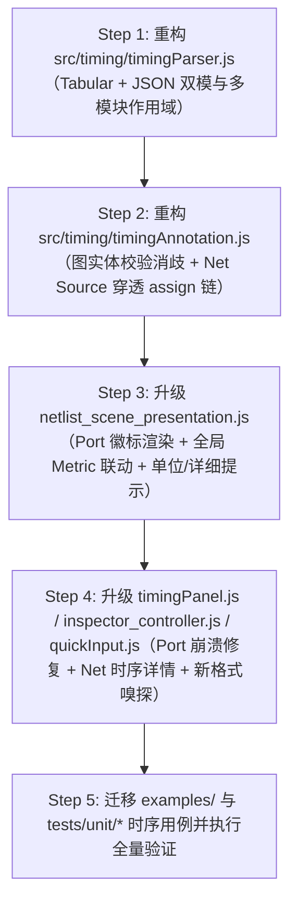

# 时序文件格式重构与原理图布局展示实现计划（经架构与代码走查修订版）

> **文档状态**：已完成深度代码走查修订 / 准备实施  
> **关联规范**：[`docs/design/timing_format_spec.md`](../design/timing_format_spec.md)  
> **涉及模块**：`src/timing/`、`src/domains/netlist/`、`src/ui/`、`src/app/`、`tools/`、`examples/`、`tests/`

---

## 0. 计划审视与关键架构修正摘要（Audit Corrections）

在对照项目现有代码库与架构边界测试（`tests/unit/architecture-boundaries.test.js`、`tests/unit/workspace-cache-dependencies.test.js`、`tests/unit/compare-workspace.test.js`）对初版计划进行深度走查后，识别并修正了以下 **7 项关键设计缺陷**：

1. **修正一：严禁在 `src/layout/nodeGeometry.js` (`measureNode`) 中引入时序尺寸耦合**
   - **初版问题**：拟在 `measureNode` 中根据时序徽标（Timing Badge）行数动态扩大节点宽高。
   - **代码实情与后果**：
     - `architecture-boundaries.test.js` 严格校验 `src/layout/nodeGeometry.js` 只能消费领域无关的几何测量字段，禁止读取 Netlist 专有的 `timing` 字段；
     - 更严重的是，工作区缓存（`workspace_identity.js`）将布局缓存（`positioned-auto`）与渲染展示解耦。如果切换侧边栏 `Timing Metric` 或勾选 `Timing Badge` 改变了节点尺寸，就会导致布局缓存失效、触发全图重新运行 H08/ELK 布局，甚至破坏手动微调（Adjust Mode）与 Layout Golden 的坐标一致性！
   - **修正方案**：保持 `measureNode` 对时序 100% 零感知。现有 `netlist_scene_presentation.js` 在存在 `timing-badge` 时已自动隐藏底部 `metadataText` 让出空间，且 `styles.css` 中 `.timing-badge` 带有 `3px` 白色描边光晕（`paint-order: stroke; stroke: #ffffff`），即使多行向下延伸也清晰可读，绝不触碰节点几何尺寸。

2. **修正二：严禁在通用渲染器 `src/render/svgRenderer.js` 与物理合线层直接读取 `edge.timing.slack`**
   - **初版问题**：拟在 `createWireRenderItems` / `createEdgePrimitive` 中直接判定 `edge.timing.slack < 0` 并给整条走线加红。
   - **代码实情与后果**：
     - `src/render/svgRenderer.js` 是领域无关的渲染器（禁止耦合 `timing.slack` 业务概念）；
     - 布局管线通过 `buildWireRoutes(edges)`（`src/layout/wireRoutes.js`）将同一条 `net` 的所有扇出逻辑边合并（Union）为一棵共享主干的物理正交线段树（`wireRoute`）。在物理布局后（Post-layout）阶段，同一条 Net 的主干可能同时扇出给一条正 Slack 分支和一条负 Slack 分支，按逻辑边染色无法映射到合并后的 `wireRoute` 主干；而如果一刀切把含负 Slack 分支的整棵 Net 树全部染成刺眼大红，在时钟网或高扇出复位网上会导致全屏红线污染。
   - **修正方案**：不污染 `svgRenderer.js` 与 `wireRoutes.js`。Net 时序严格遵循规范挂载至其 **Source 驱动端（Input Port 或驱动 Cell 的输出 Pin）** 并存入 `graph.netTiming[netName]`；关键路径通过 **驱动端红框 + 源/宿引脚红点（`.pin-critical`）+ 选中连线时详情面板展示 Net Source 时序** 来精确表达，既遵守分层边界，又避免高扇出网表的视觉灾难。

3. **修正三：修复 `assign` 连续赋值别名折叠吞噬 Net 时序的隐患**
   - **初版问题**：未考虑 `buildWorkspaceGraph`（`src/domains/netlist/netlist_graph_projection.js`）中 `annotateGraphTiming` 与 `normalizeGraphAliases` 的执行先后顺序。
   - **代码实情与后果**：在 `buildWorkspaceGraph` 中，`annotateGraphTiming` 在第 46 行执行，而折叠并删除 `assign` 节点的 `normalizeGraphAliases` 在第 47 行执行！如果时序文件中的 `point` 是一个由 `assign w_alias = w_src;` 驱动的别名线网，直接查找 `graph.edges` 找到的驱动节点是 `assign` 节点；紧接着下一步 `normalizeGraphAliases` 就会把该 `assign` 节点从图中删掉，导致挂载的时序凭空消失！
   - **修正方案**：当 `point` 命中某条 `net` 并向 Source 驱动端回溯时，在 `annotateGraphTiming` 内部沿 `assign` 节点链向上游穿透，直至找到真正的非 `assign` 物理驱动源（`input` Port 或 `cell` 输出 Pin），同时在 `graph.netTiming` 中为原别名与根线网名双份登记时序。

4. **修正四：支持单文件多 `@module` 作用域以兼容 Compare 对比工作区**
   - **初版问题**：假设每份 `TimingDataset` 只有一个全局 `module: string | null`。
   - **代码实情与后果**：在 `src/app/state.js` 中全局仅维护一份 `state.timing`，并在 Compare 模式下同时传给 `leftModule`（如 `hier_escape_before`）和 `rightModule`（如 `hier_escape_after`）。现有示例 `examples/hierarchical_escaped_timing.txt` 与单元测试 `tests/unit/compare-workspace.test.js` 均依赖单份时序文件包含多个模块的时序数据。
   - **修正方案**：在 Tabular 格式中支持出现多个 `@module <name>` 分段指令（在 JSON 格式中支持顶层 `"modules": { "<mod>": { "points": ... } }`），解析器将记录按模块名归入 `TimingDataset.scopes[moduleName]`（未指定模块的记录归入 `scopes["__default__"]`），实现单模块极简使用与多模块 Compare 视图的无缝兼顾。

5. **修正五：修复含 `/` 的 Verilog 转义端口/线网名被误判为 `<instance>/<pin>` 的漏洞**
   - **初版问题**：拟在词法层面见到 `/` 就按优先级 1 拆分为 `<instance>/<pin>`。
   - **代码实情与后果**：在综合扁平化网表（如 `examples/hierarchical_escaped_compare.v`）中，顶层端口名本身就是 `\u_dp_add_0/w_gen_1207`、内部线网名本身就是 `\u_dp_add_0/w_gen_960`（归一化后均含 `/`）。若盲目按最后一个 `/` 切分，会把端口 `\u_dp_add_0/w_gen_1207` 误拆成不存在的实例 `u_dp_add_0` 上的引脚 `w_gen_1207`，导致整个模块的端口时序全部匹配失败！
   - **修正方案**：消歧逻辑必须结合当前 `graph` 中的真实实体表进行校验：
     1. 若显式指定了 `kind`（`port` | `pin` | `net`），严格在对应实体表中查找；
     2. 未指定 `kind` 时：先尝试按最后一个 `/` 切分 `<instance>/<pin>`，**仅当 `<instance>` 确实命中当前 `graph` 中存在的 `cell` 节点时**，才将其判定为 Cell Pin；否则退回将完整名称与 `graph` 的 `input`/`output` Port 比对；若仍未命中，再与 `graph` 的 Net 集合比对。

6. **修正六：保持 `TimingDataset` 纯对象无环结构与 `recordCount` / `instanceCount` 调用契约**
   - **初版问题**：拟在 `TimingDataset` 中同时存放 `records: Array` 与 `points: Map`，且遗漏了 `recordCount` / `instanceCount` 统计字段。
   - **代码实情与后果**：
     - `src/domains/netlist/timing_import.js`、`tools/launcher-options.mjs`、`src/app/input_controller.js`、`src/app/inspector_controller.js` 均强依赖 `timing.recordCount` 与 `timing.instanceCount`（缺失会导致 CLI `--timing` 和 UI 导入直接报错拒绝）；
     - `src/app/workspaceArtifactCache.js` 的 `createWorkspaceArtifactKey` 会递归遍历并序列化 `state.timing` 生成缓存签名，若同时存 `Array` 和 `Map` 会使序列化体积翻倍。
   - **修正方案**：`TimingDataset` 保持纯对象与数组结构（包含 `records`, `scopes`, `recordCount`, `instanceCount`, `diagnostics`），查找索引 `Map` 仅在 `annotateGraphTiming` 执行期间临时构建。

7. **修正七：补齐 Port 节点徽标渲染、Port 选中崩溃修复、Net 选中时序面板及左侧全局 Metric 联动**
   - **初版问题**：忽略了现有 UI 针对 Port 与 Net 时序展示的多处断层，以及移除 `Global/Local` 表格后遗留的死控件。
   - **代码实情与后果**：
     1. **点击带时序的 Port 节点会崩溃**：`src/ui/timingPanel.js` 第 19 行直接执行 `Object.values(node.timing.pins)`，而 Port 节点的 `node.timing` 没有 `pins` 字典，点击即抛 `TypeError: Cannot convert undefined or null to object`！
     2. **Port 节点在画布上没有可见时序徽标**：`src/domains/netlist/netlist_scene_presentation.js` 的 `createPortPrimitive` 只把时序写进了 `<title>` 悬停提示，从未调用 `createTimingBadge`，导致 Pre-map 阶段导入端口时序后画布上看不到任何数值徽标。
     3. **点击选中导线（Net）时详情面板不显示任何时序**：`src/app/inspector_controller.js` 的 `renderNetSelection(netName)` 完全没有读取时序信息。
     4. **左侧 `Timing` 面板策略脱节**：旧版左侧 `Snapshot: Auto/Global/Local` 在废弃 Global/Local 表后失去意义；且旧版 `Metric` 下拉框对 Cell 节点完全失效（`getDefaultBadgeChoices` 硬编码显示输入的 `at` 和输出的 `at`/`slack`）。
   - **修正方案**：
     - 在 `createPortPrimitive` 中补齐 Port 节点的 `createTimingBadge` 渲染；
     - 在 `timingPanel.js` 中同时支持 Cell 节点（多引脚表）与 Port 节点（单端口时序表与徽标勾选）；
     - 在 `renderNetSelection(netName)` 中读取 `graph.netTiming[netName]`，在详情面板中展示该线网的 Source 时序与驱动源信息；
     - 将左侧 `Timing` 面板的 `Snapshot` 替换为展示当前时序元信息（`Stage` / `Unit`），并将 `Metric` 选择器升级为全局默认徽标策略（支持 `slack`、`at`、`rt`、`delay`、`slew`、`all`，当节点未设置单实例手动覆盖 `timingBadgeChoices` 时，统一响应全局 `Metric` 选择）。

---

## 1. 架构设计与数据流图

```text
  [时序源文件 / 剪贴板文本] (.txt / .log / .csv / .tsv / .json)
                          │
                          ▼
             src/app/quickInput.js
        (快速类型嗅探：区分 Netlist / Golden / Timing)
                          │
                          ▼
             src/timing/timingParser.js
        (列式文本与 JSON 双模解析，支持多 @module 作用域与缺失值推导)
                          │
                          ▼ 【输出纯对象无环 TimingDataset IR】
        src/domains/netlist/timing_import.js
                          │
                          ▼ 【存入 State & 生成确定性工作区缓存键】
        src/timing/timingAnnotation.js
        (结合当前图实体消歧：Cell Pin / Port / Net Source 穿透 assign 链)
                          │
                          ▼ 【产生 annotatedGraph（含 node.timing 与 graph.netTiming）】
      ┌───────────────────┴───────────────────┐
      ▼                                       ▼
src/diagram/measure_graph.js       src/domains/netlist/netlist_scene_presentation.js
(保持对时序零感知，确保布局缓存稳定)  (生成 Scene：Cell/Port 红蓝边框、引脚状态、Port/Cell 徽标)
      │                                       │
      ▼                                       ▼
src/layout/ (H08 / ELK / Simple)   src/render/svgRenderer.js
(执行无干扰确定性布局与正交合线)      (领域无关高性能 SVG 绘制)
```

---

## 2. 详细分阶段实施方案

### 第一阶段：解析引擎重构（`src/timing/timingParser.js`）

#### 2.1 彻底移除旧解析逻辑
- 删除旧 `LocResyn timing` 正则（`INSTANCE_PATTERN`、`PIN_PATTERN`）与 `Global/Local` 边界表格解析逻辑（`DYNAMIC_HEADER_PATTERN`、`TABLE_ROW_LEADING`、`TABLE_ROW_TRAILING`、`parseBoundaryTableLine`、`finalizeBoundaryTable`）。
- 移除旧 `boundaryTables`、`snapshots` 等废弃数据结构。

#### 2.2 实现双模统一解析器 `parseTimingLog(text)`
1. **格式自动嗅探**：
   - 忽略前导空白及行注释（`#` 或 `//`）后，若首个有效字符为 `{`，分流至 `parseTimingJson(text)`；
   - 否则分流至 `parseTimingTabular(text)`。
2. **列式文本解析器（`parseTimingTabular`）**：
   - **头部与分段指令**：
     - `@module <name>`：切换当前模块作用域（支持单文件内出现多次 `@module` 以承载 Compare 模式的多个模块）；
     - `@stage <pre_map|post_map|post_layout>`：设置阶段标识（默认 `post_map`）；
     - `@unit <ns|ps>`：设置时间单位（默认 `ns`）；
   - **分词与转义保护**：
     - 支持双引号 `"..."` 包裹含空格或逗号的标识符；
     - 支持 Verilog 转义标识符（如 `\u_inst[0] /A1`，将转义名内部末尾空格与 `/` 接合后再分词）；
     - 若非引号区间包含逗号 `,`，按 CSV 模式切分；否则按连续空白字符（空格/Tab）切分；
   - **表头自适应映射**：
     - 若首个非注释数据行首列命中 `point` / `name` / `pin` / `object`（不区分大小写），则解析为表头行；
     - 支持列名映射：`point` (`name`/`object`)、`at` (`arrival`)、`rt` (`rat`/`required`)、`slack`、`delay` (`incr`)、`slew` (`trans`/`transition`)、`edge` (`rf`/`pol`)、`kind` (`type`)；
     - 若未提供表头，默认按 4 列简单模式 `[point, at, rt, slack]` 解析（若存在第 5~8 列则依次对应 `delay, slew, edge, kind`）；
   - **数值解析与三知二推导**：
     - `-`、`NA`、`N/A`、`null`、`*`、`""` 统一解析为 `null`；
     - 若 `slack === null` 且 `Number.isFinite(at) && Number.isFinite(rt)`，自动计算 `slack = Number((rt - at).toFixed(6))` 并标记 `slackDerived: true`。
3. **结构化 JSON 解析器（`parseTimingJson`）**：
   - 支持单模块结构（顶层 `"module"` + `"points"`）与多模块结构（顶层 `"modules": { "<modName>": { "points": { ... } } }`）；
   - `"points"` 的值支持紧凑数组 `[at, rt, slack]`（或 `[at, rt]` 自动推导 `slack`）与详细对象 `{ at, rt, slack, delay, slew, edge, kind }` 混用。
4. **统一输出结构（满足缓存与调用方契约）**：
   ```javascript
   {
     version: "1.0",
     format: "tabular" | "json",
     module: string | null,                   // 首个/默认模块名
     stage: "pre_map" | "post_map" | "post_layout",
     unit: "ns" | "ps",
     records: TimingPointRecord[],            // 全部有效记录数组
     scopes: Record<string, TimingPointRecord[]>, // 按模块名分组（无模块归入 "__default__"）
     recordCount: number,                     // 有效记录总数
     instanceCount: number,                   // 独立对象/实例数统计
     diagnostics: Diagnostic[]
   }
   ```

---

### 第二阶段：时序标注与图实体消歧（`src/timing/timingAnnotation.js`）

#### 2.3 作用域选择与名称归一化
1. **作用域提取**：
   - 根据当前 `graph.moduleName`，从 `timing.scopes` 中提取匹配该模块名的记录列表，并合并 `timing.scopes["__default__"]` 中的全局记录（模块专属记录优先级高于全局记录）。
2. **标识符归一化辅助函数**：
   - 复用或对齐 `normalizeTimingIdentifier`：剥离前导 `\`、消除转义标识符紧随 `/` 前的空白字符（如 `\u_leaf$0 /A` ➔ `u_leaf$0/A`），并提供剥离当前模块名前缀（如 `alu_core/u_add/A` ➔ `u_add/A`）的候选路径。

#### 2.4 图实体校验消歧与 `assign` 穿透挂载
针对每条 `TimingPointRecord`：
1. **构建当前图的快速查找表（仅在 `annotateGraphTiming` 内部临时构建）**：
   - `cellByNormName`: 当前图中所有 `node.kind === "cell"` 节点的归一化名称/层级后缀索引；
   - `portByNormName`: 当前图中所有 `node.kind === "input" || node.kind === "output"` 节点的归一化名称索引；
   - `netSourceMap`: 遍历 `graph.nets` 与 `graph.edges`，为每条 `net` 解析其最终非 `assign` 物理驱动源（沿着 `node.kind === "assign"` 节点向上游回溯，直到找到 `input` Port 或 `cell` 输出 Pin，同时记录 `assign` 别名根网表名）。
2. **三步消歧匹配**：
   - **当 `record.kind === "pin"`，或 `record.kind === null` 且路径含 `/` 时**：
     - 尝试按最后一个 `/` 切分为 `<instCandidate>` 与 `<pinName>`；
     - 在 `cellByNormName` 中查找 `<instCandidate>`（支持完整匹配与唯一最长层次后缀匹配）；
     - **若命中唯一 Cell 节点**：将时序挂载至该 Cell 的 `node.timing.pins[pinName]`。
     - **若存在多个同名后缀 Cell 实例**：记录 `ambiguous-instance` 诊断告警，不执行错误覆盖。
   - **当 `record.kind === "port"`，或上一步未命中任何 Cell 且匹配 `portByNormName` 时**：
     - 将时序挂载至该 Port 节点：`node.timing = createPortTimingSummary(record, unit)`（同时包含顶层 `at/rt/slack/delay/slew/edge/worstSlack` 以及 `pins: { [portPinName]: pinSummary }`，从而使 Port 与 Cell 共享统一的数据访问结构！）。
   - **当 `record.kind === "net"`，或前两步均未命中且匹配 `netSourceMap` 时**：
     - 将该记录存入 `graph.netTiming[net.name]`（及其 `assign` 根网表名）；
     - 查找该 Net 穿透 `assign` 链后的物理 Source 驱动端：
       - 若驱动端为 `input` Port 且该 Port 尚未挂载显式 Port 时序，则注入该 Port 的 `node.timing`（标记 `sourceKind: "net"`，`sourceNet: net.name`）；
       - 若驱动端为某 Cell 的输出引脚 `outPin` 且该引脚尚未挂载显式 Pin 时序，则注入该 Cell 的 `node.timing.pins[outPin]`（标记 `sourceKind: "net"`，`sourceNet: net.name`）。
3. **汇总计算**：
   - 对每个挂载了时序的 Cell / Port 节点计算 `worstSlack`、`worstPin`，统计 `matchedRecordCount`、`unmatchedRecordCount` 等写入 `graph.timingSummary`。

---

### 第三阶段：原理图场景呈现与徽标策略（`src/domains/netlist/` & `src/ui/`）

#### 2.5 严守几何与渲染边界
- **不修改 `src/layout/nodeGeometry.js`**：保持节点尺寸完全由网表结构与标签长度决定，确保切换任何时序视图或徽标选项时**零重算布局（Zero Re-layout）**。
- **不修改 `src/render/svgRenderer.js` 与 `src/layout/wireRoutes.js`**：保持物理合线与底层 SVG 渲染器的领域中立性。

#### 2.6 升级 `src/domains/netlist/netlist_scene_presentation.js`
1. **统一时间单位与详细指标格式化**：
   - 根据 `graph.timingSummary.unit`（`ns` 或 `ps`）格式化徽标与 `<title>` 提示；
   - 引脚 `<title>` 悬停提示完整展示：`A1: at 0.728ns, rt 0.717ns, slack -0.011ns, delay 0.098ns, slew 0.045ns (fall)`。
2. **新增 Port 节点可见时序徽标（修复旧版 Port 无徽标问题）**：
   - 在 `createPortPrimitive` 中调用 `createTimingBadge`，使 Input / Output Port 节点在导入 Pre-map / Post-map 时序后，也能像 Cell 一样在节点下方清晰呈现 `at` / `rt` / `slack` 徽标，并在有徽标时自动隐藏底部类型文字。
3. **升级 `getDefaultBadgeChoices` 以联动左侧全局 `TimingDisplayPolicy`**：
   - 当用户未对某个节点进行单实例复选框覆盖（`state.timingBadgeChoices[instanceName]`）时，根据左侧 `Timing -> Metric` 选择的指标（如 `slack`、`at`、`rt`、`delay`、`slew`）动态生成该节点（Cell 或 Port）的默认徽标行；
   - 默认模式（如选择 `slack` 或默认综合视图）保持精简，避免徽标过长。

---

### 第四阶段：交互控制与检查面板（`src/ui/` & `src/app/`）

#### 2.7 侧边栏 `Selection` 详情面板升级（`src/ui/timingPanel.js` & `src/app/inspector_controller.js`）
1. **修复 Port 节点选中崩溃并支持 Port 徽标开关**：
   - 由于第二阶段已为 Port 的 `node.timing` 统一提供了 `pins` 结构（或兼容处理单端口记录），点击带时序的 Input / Output Port 时，`renderTimingPanel` 将正常渲染端口时序表与徽标复选框，不再抛出 `Object.values(undefined)` 异常。
2. **扩展详细模式列（`Delay` / `Slew` / `Edge`）**：
   - 当选中节点的时序记录包含非空的 `delay`、`slew` 或 `edge` 字段时，`renderTimingPanel` 自动扩展展示对应列，并允许勾选 `delay` / `slew` 投射到画布徽标。
3. **新增选中导线（Net）时的时序展示（`renderNetSelection`）**：
   - 在 `src/app/inspector_controller.js` 的 `renderNetSelection(netName)` 中，检查 `graph.netTiming?.[netName]`（或回退查找其驱动端时序）；
   - 若存在时序，在 Net 详情区展示 `Net Timing (Source): at / rt / slack / delay / slew` 以及其物理驱动端标识。

#### 2.8 左侧 `Timing` 控制面板与快捷输入升级
1. **清理废弃的 `Global/Local` 控件（`index.html`、`src/ui/timing_display_controller.js`、`src/app/inspector_controller.js`）**：
   - 移除或隐藏已废弃的 `Snapshot: Auto / Global / Local` 下拉框，展示当前导入时序的 `@stage`（Pre-map / Post-map / Post-layout）与 `@unit`（ns / ps）摘要信息；
   - 扩展 `Metric` 选择器支持 `slack`、`at`、`rt`、`delay`、`slew`。
2. **升级快速嗅探与粘贴弹窗（`src/app/quickInput.js`、`src/ui/quick_input_controller.js`、`index.html`）**：
   - 在 `detectQuickInputKind` 中移除旧 `locresyn` / `boundary` 嗅探，新增对新标准时序格式（JSON `"points"` / `"modules"`、指令头 `@module` / `@stage` / `@unit`、表头 `point at rt slack` 及 4 列数值时序行）的精准识别；
   - 更新顶部 `Paste timing` 按钮提示与弹窗占位符示例。

---

### 第五阶段：周边工具链、示例与测试套件全量迁移

#### 2.9 示例文件与 CLI 工具同步
- 更新 [`examples/hierarchical_escaped_timing.txt`](../../examples/hierarchical_escaped_timing.txt)：改写为包含 `@module hier_escape_before` 与 `@module hier_escape_after` 两个分段的新标准列式格式，保留对含 `/` 转义端口名（`\u_dp_add_0/w_gen_1207`）与层级转义实例引脚（`u_stage1/\u_leaf$0 /A`）的覆盖。
- 检查 `tools/launcher-options.mjs` 与 `src/domains/netlist/timing_import.js`：确保 `recordCount`、`instanceCount` 校验逻辑与新 `TimingDataset` 完全匹配。

#### 2.10 单元测试与架构测试验证矩阵
1. **重写 `tests/unit/timing-stage6.test.js`**：
   - 全面测试 Tabular（空格、Tab、CSV、无表头默认 4 列、带表头详细列）与 JSON（紧凑数组、详细对象、多模块 `modules`）解析；
   - 测试缺失值（`-`, `NA`, `null`）与 `slack = rt - at` 自动推导；
   - 测试 **含 `/` 的转义端口名与单元引脚消歧**；
   - 测试 **Net 时序穿透 `assign` 别名链挂载至 Source 驱动端**；
   - 测试 Port 节点与 Cell 节点的徽标生成及 `renderTimingPanel` 渲染（验证点击 Port 节点零报错）。
2. **更新关联集成测试**：
   - 更新 `tests/unit/graph-render.test.js`、`tests/unit/compare-workspace.test.js`、`tests/unit/quick-input.test.js` 中的旧格式内联时序样例；
   - 运行 `npm test`、`npm run test:architecture`、`npm run test:docs`，确保 100% 通过且不触碰 `main.js` 行数上限与分层边界。

---

## 3. 实施步骤与交付物清单



| 阶段 | 涉及文件 | 关键验收指标 |
| :--- | :--- | :--- |
| **Step 1** | `src/timing/timingParser.js`<br>`src/domains/netlist/timing_import.js` | 支持 Tabular/CSV/JSON、简单与详细模式、多 `@module` 作用域，输出无环纯对象且含 `recordCount`/`instanceCount` |
| **Step 2** | `src/timing/timingAnnotation.js`<br>`src/domains/netlist/netlist_graph_projection.js` | 准确区分含 `/` 的转义 Port 与 Cell Pin；Net 时序穿透 `assign` 链挂载至 Source 端并记录 `graph.netTiming` |
| **Step 3** | `src/domains/netlist/netlist_scene_presentation.js` | 零修改 `nodeGeometry.js`/`svgRenderer.js`；Port 与 Cell 均支持动态徽标并响应全局 `Metric` 切换 |
| **Step 4** | `src/ui/timingPanel.js`<br>`src/ui/timing_display_controller.js`<br>`src/app/inspector_controller.js`<br>`src/app/quickInput.js`<br>`index.html` | 点击带时序 Port 节点不崩溃且可开关徽标；点击 Net 显示 Source 时序；粘贴自动识别新格式 |
| **Step 5** | `examples/hierarchical_escaped_timing.txt`<br>`tests/unit/timing-stage6.test.js`<br>`tests/unit/graph-render.test.js`<br>`tests/unit/compare-workspace.test.js`<br>`tests/unit/quick-input.test.js` | `npm test`、`npm run test:architecture`、`npm run test:docs` 全部零错误通过 |
