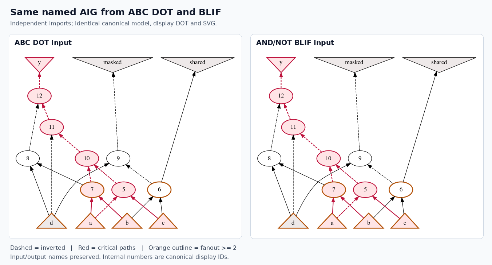

# ABC DOT 与 BLIF 的同图要求及实跑验证

日期：2026-11-14。用户已确认输入来源为 **ABC 导出的 AIG DOT**，以及 **已展开为 AND/NOT 的 BLIF**。

后续主界面接入的阶段、隔离边界与验收条件已整理到 [AIG 主界面接入计划](../plans/aig_graphviz_integration.md)，状态为待实施。本文仍记录此前的研究原型结果。

## 确定的显示与输入要求

| 项目 | 要求 |
| --- | --- |
| 输入名称 | 图中直接显示原始 PI 名称，本样例为 `a/b/c/d` |
| 输出名称 | 图中直接显示原始 PO 名称，本样例为 `y/shared/masked` |
| 内部节点 | 使用稳定的显示编号；保留原 DOT 节点 ID / BLIF 信号名到显示节点的来源映射，用于定位 |
| 图形风格 | 参考 mockturtle：BT、逻辑深度分组、AND 椭圆、PI / PO 正倒三角、Graphviz 样条与箭头 |
| 反相表达 | 统一为逻辑边上的虚线，包括输出反相；不新增可见 NOT 门 |
| 分析高亮 | 关键路径红色、扇出边框；保留虚实线语义，切换时不改变几何 |
| 输入支持 | ABC 的 AIG `write_dot` 方言；单模型、平坦、二输入 AND 与 NOT / BUF / 常量组成的 BLIF |
| 一致性 | 同一 AIG 结构、同名 PI/PO、同一规范化与显示配置，得到相同布局及分析结果 |

“一致”不是分别直接渲染两个源文件，而是两者都进入同一条显示路径：

~~~text
ABC AIG DOT ──语法解析 / ABC 语义适配──┐
                                    ├─ 统一 AIG → 稳定显示 DOT → Graphviz dot → AIG Scene
AND/NOT BLIF ─语法解析 / AND-NOT 还原─┘         └─ 逻辑深度、关键路径、扇出 ────────┘
~~~

DOT 原来的标题、时间戳、Level 辅助节点、`rankdir`、`size`、坐标、颜色和 rank 分组不参与最终布局。原始端口标签、实际连接方向和反相信息必须保留。输入的声明顺序与内部编号不作为布局顺序依据。

源数据与规范化结果分开保存。BUF / NOT 归一化为信号别名和极性；AND 的两个逻辑输入按稳定结构键排列，原始引用另存。研究原型没有执行 rewrite、resyn、平衡或合并重复 AND。

## 从两种实际输入生成的图

ABC 从同一个 `shared_cone.aig` 一次读取后分别执行 `write_dot` 与 `write_blif`。两份真实输出分别经过导入器、规范化与布局，未用其中一种生成的模型冒充另一种导入结果。

两图均保留输入输出名称。内部数字是统一显示编号，不是 ABC 内部编号或 BLIF 信号名；具体来源可查映射文件。

本样例的结果如下：

| 检查 | 实测结果 |
| --- | --- |
| 规范化 AIG | 两份 JSON 完全一致：4 PI、8 AND、3 PO、19 边 |
| 极性 | 两者均为 10 条反相边 |
| 分析结果 | 完全一致：深度 4、9 条关键边、6 个引用数 ≥ 2 的节点 |
| 显示 DOT | 字节一致 |
| 原始 SVG | 字节一致，包含节点位置、曲线、箭头和标签 |
| 高亮 SVG 与 PNG | 分别字节一致；高亮前后几何保持不变 |
| 逻辑检查 | 两条导入路径的全部 16 组输入真值都与原始 AAG 一致 |
| 顺序与名字扰动 | DOT、BLIF 各 12 组：调整声明顺序、内部标识；BLIF 另交换 fanin 与对应真值表列，规范化结果均不变 |
| NOT / BUF | 显式反相链、正相别名链与表内反相得到相同模型 |
| 其他专项 | 常量、重复 fanin 槽位、名称转义、输入不可变；错误方向、环、缺失信号、多驱动及不支持语义有明确错误 |

12 项研究测试全部通过。图形检查运行于 `mfs-remote`，Graphviz 为 2.43.0；这是固定样例与受限格式原型验证，不代表生产导入已上线。

文件：[ABC DOT 输入](assets/aig_dot_blif_2026_11_14/abc_input.dot)、[BLIF 输入](assets/aig_dot_blif_2026_11_14/abc_input.blif)、[统一模型](assets/aig_dot_blif_2026_11_14/canonical.json)、[统一显示 DOT](assets/aig_dot_blif_2026_11_14/canonical.dot)、[DOT 路径 SVG](assets/aig_dot_blif_2026_11_14/from_dot.svg)、[BLIF 路径 SVG](assets/aig_dot_blif_2026_11_14/from_blif.svg)、[无高亮 SVG](assets/aig_dot_blif_2026_11_14/named_plain.svg)、[检查与哈希](assets/aig_dot_blif_2026_11_14/checks.json)、[DOT 来源映射](assets/aig_dot_blif_2026_11_14/from_dot_provenance.json)、[BLIF 来源映射](assets/aig_dot_blif_2026_11_14/from_blif_provenance.json)。

## 两种格式的关键差异

| 来源 | 需要还原的语义 |
| --- | --- |
| ABC AIG DOT | `consumer -> fanin` 配合 `dir=back`；`dotted` 表示反相。可见逻辑边反向转换为信号流，忽略 invisible 辅助边与 plaintext 标题 / Level 节点 |
| AND/NOT BLIF | `.names` 表中 0/1/- 描述输入条件；ON / OFF cover 都需要解释。输出反相可能直接编码在 AND 节点的 OFF cover 中 |
| 名称 | DOT 从 PI/PO 的 label 读取；BLIF 从 `.inputs/.outputs` 读取。不能用源文件内部 ID 替代用户名称 |
| 统一输出 | 重新计算深度与分析、排序并编号、生成同一套形状和虚线规则；不保留 ABC 的标题尺寸或 BLIF 的别名门 |

例如本次 ABC BLIF 的 `.names new_n11 new_n12 y` 配合 `00 0`，表示 `y = !(!new_n11 & !new_n12)`。因此规范化后包含一个双反相 fanin 的 AND，以及输出边上的反相；不能把末列 `0` 当作“没有这条逻辑”。[Berkeley BLIF 格式规范](https://www.cs.columbia.edu/~cs6861/sis/blif/index.html)

DOT 是通用图描述，不自带 AIG 语义。本轮使用 Graphviz 的 `dot_json` 解析语法，再由 ABC 方言适配器解释；不能将一般逻辑网表的 ABC DOT 自动假设为 AIG。`dot_json` 不执行布局，最终显示 DOT 才交给 `dot -Tsvg` 布局。[Graphviz JSON 输出](https://graphviz.org/docs/outputs/json/)

## 一致性边界与当前实现状态

- 保证目标是**同一带名称的 AIG 结构**。只有布尔功能等价、但共享节点或 AND 分解不同的电路，可能具有不同图；本项目不为“看起来一样”执行逻辑等价归约。
- 相同结构与名称之外，还需固定规范化版本、Graphviz 版本、字体与显示设置。不同平台和字体不能仅凭同一份 DOT 保证像素完全相同。
- 目前交付的是可运行研究 CLI 与上述实图，位于 `tools/research/aig_layout_comparison`。生产浏览器的文件导入、AIG 领域注册、搜索定位、Scene 和 Graphviz/WASM 离线发布尚未接入。没有改动网表默认布局或 Simple。
- 原型只支持组合、平坦的 AIG 子集。`.gate/.subckt/.latch`、多输入一般逻辑、混合 ON/OFF cover 等显式拒绝，不静默丢弃或错误降级。
- 原型遇到两个结构完全相同但身份独立的 AND 会明确拒绝；它不会偷偷合并节点。正式导入器还需解决此类来源身份与规范化映射，再将这类图纳入“一致”验收。重复 fanin 槽位已单独保留和验证，两者不是一回事。
- ABC 的其他 DOT 导出入口、锁存器/属性节点、不同版本的常量表示，还需增加真实样例验证；当前证据来自本文保存的 `write_dot` 输出。

原型与复现：[导入和规范化](../../tools/research/aig_layout_comparison/aig_input.py)、[专项测试](../../tools/research/aig_layout_comparison/test_aig_input.py)、[双路径绘图](../../tools/research/aig_layout_comparison/render_dual_format.py)、[运行说明](../../tools/research/aig_layout_comparison/README.md)。
