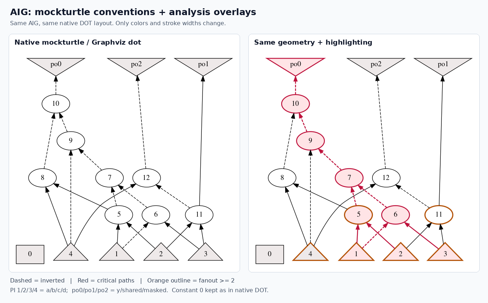

# AIG 的 mockturtle 风格验证与选型修正

日期：2026-11-14。目标按用户反馈明确为：**熟悉 mockturtle / Graphviz 的用户可以直接读图，保留其节点、分层、曲线与反相边习惯。**

后续确认：PI/PO 使用实际名称，不沿用原生 drawer 的 `1/2/po0` 标签；输入支持 ABC AIG DOT 与 AND/NOT BLIF，并要求两条路径同图。最新带名称实图与验证见 [双格式一致性](aig_dot_blif_consistency.md)。本文原生编号图保留为最初的风格基线。

**AIG 视图优先采用 Graphviz dot，复用工作台与通用 Scene 渲染基础。现有 AnchorLayered / ELK 正交路径继续服务门级网表。** 这是 AIG 接入路线的建议，本轮没有切换产品默认提供器，也没有实现生产 AIG 导入或交互功能。

## 为什么修正上一轮结论

[上一轮三布局器实验](aig_provider_comparison.md)统一成了 LR、矩形节点、左右固定端口、输入端反相气泡，并取消显式逻辑深度分组。这能比较“在现有工程原理图显示规则下的紧凑 AIG”，但不能验证“是否接近 mockturtle 的默认效果”。即使 Graphviz 使用曲线，它收到的显示图与约束也已经不同。

因此，不应以该样例的面积、折点和正交校验结果推荐 AnchorLayered 作为这次目标下的 AIG 主线。其能处理紧凑 AIG 的结论仍成立；这不等于它能直接提供用户要求的外观。

## 同样例的修正版实图

左图重新运行原生 mockturtle 导出的 DOT；右图在其 SVG 上叠加分析样式。两图都使用 Graphviz 2.43.0，图中各几何元素按相同尺度展示。

| 项目 | 本图采用的规则 |
| --- | --- |
| 分层与方向 | `rankdir=BT`，PI / 常量在底层；AND 按逻辑深度 `rank=same` 分组；PO 在共同顶层 |
| 节点 | AND 为椭圆，PI 为正三角形，PO 为倒三角形，常量为方框；使用原生默认尺寸与编号 |
| 走线 | 原生 dot 样条与箭头；不约束为网表左右引脚，不转为正交折线 |
| 反相 | 完整逻辑边为虚线，普通边为实线；PO 反相同样使用虚线 |
| 关键路径 | 淡红节点填色与红色边，保留原有虚实线；统计所有最长逻辑路径，AND 单位延迟，不是器件 STA |
| 扇出 | 引用数 ≥ 2 的节点使用橙色边框；具体计数存入 SVG 悬浮标题，包含 PO 引用 |
| 样式叠加 | 红色填充表示关键节点，橙色边框表示高扇出；节点 4 仅有橙框，节点 5 同时有红填充与橙框 |
| 高亮切换 | 只修改颜色和线宽，不改变尺寸、标签、坐标或路径 |

同一输入仍为 4 PI、8 AND、3 PO、19 条边、10 条反相边。本次按原生 mockturtle 输出保留未使用的常量 0，因此显示 16 个节点；前轮紧凑实验省略了该常量，显示 15 个节点。没有添加或优化逻辑。

检查确认两版所有节点几何、曲线控制点、箭头多边形、文字与变换完全相同；反相虚线一致。高亮包含 9 个显示节点、9 条关键边、6 个高扇出节点，实体节点的深度、关键性和扇出与前次 aigverse 结果逐项一致。[检查结果](assets/aig_mockturtle_style_2026_11_14/checks.json)

独立文件：[原生 SVG](assets/aig_mockturtle_style_2026_11_14/mockturtle_native.svg)、[高亮 SVG](assets/aig_mockturtle_style_2026_11_14/mockturtle_highlight.svg)、[实际 DOT](assets/aig_mockturtle_style_2026_11_14/mockturtle.dot)。脚本与执行方式见 [复现说明](../../tools/research/aig_layout_comparison/README.md)。

## 对现有项目的取舍

| 能力 | 推荐处理 |
| --- | --- |
| 节点排列、曲线走线 | Graphviz dot；AIG 投影提供 mockturtle 风格的形状、层级、标签和边属性 |
| AIG 极性、逻辑深度、关键路径、扇出 | AIG 模型与分析负责；Graphviz 不推导电路语义 |
| SVG 绘制、选择、平移缩放、会话、比较 | 复用通用工作台与 Scene 基础，补齐 AIG 对象映射和装配 |
| 网表 cell 尺寸、固定引脚、共享正交线干 | AIG 默认路径不复用；按独立逻辑边保留槽位与极性 |
| 手工节点拖动与 Adjust | 当前依赖正交重布线，不能直接套给曲线；需明确曲线能力接口并单独验证，不能声称现成支持 |
| 离线浏览器运行 | 候选为随包固定版本的 Viz.js / WASM Graphviz；本次使用服务器原生 dot，尚未验证浏览器包体、Worker、性能和发布流程 |

只给 AnchorLayered 的直角转弯加圆角，不能得到同样效果：节点分层、端点选择、跨层边通道仍是现有正交约束的结果。只让 Graphviz 放节点，再接现有正交路由，也会失去这里保留的曲线习惯。

不必为复现视觉习惯引入整个 mockturtle C++ 库作为前端运行时。需要复现的是其 DOT 导出约定，再交给 Graphviz；源模型与分析仍属于项目自己的 AIG 领域。mockturtle 的实际导出器也支持定制 drawer。[mockturtle write_dot 源码](https://github.com/lsils/mockturtle/blob/a3f817de4005ee6ae12b4dd1ffcf4a4f910691d7/include/mockturtle/io/write_dot.hpp)

Graphviz `dot` 默认支持样条；通过 JSON 绘图指令可以取回曲线几何，Viz.js 提供对应浏览器入口。因此可转换为受控的 AIG Scene，继续使用通用渲染器，不必将整张外部 SVG 当作产品黑盒。[Graphviz splines](https://graphviz.org/docs/attrs/splines/)、[Graphviz JSON](https://graphviz.org/docs/outputs/json/)、[Viz.js API](https://viz-js.com/api/)

后续验收应先检查上述视觉约定，再评估宽层、高扇出、长链、重汇聚和寄存器边界的可读性与运行成本。固定版本、字体和导出约束后才能做几何回归；不同 Graphviz 版本与字体不保证像素级一致。布局输入仍需按稳定拓扑键规范化并做排列不变性检查，这次单样例视觉验证未覆盖该生产要求。
