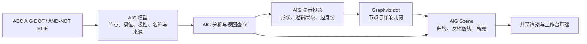

# 现有项目的 AIG 布局接入评估

评估日期：2026-11-14。代码依据为当前工作区，包含本轮架构重构中的 MeasuredGraph 边界；不以旧版架构或 Git HEAD 代替当前文件。开源工具与三工具实跑图见 [AIG 绘图调研](aig_visualization_tools.md)。

## 建议选择

**AIG 视图优先采用 Graphviz dot，保留 mockturtle 的分层、形状、曲线与虚线反相约定；复用现有工作台与通用 Scene 渲染基础。** 现有 AnchorLayered / ELK 继续服务门级网表，不因这次研究改变其默认策略。

用户已明确要求接近 mockturtle / Graphviz 的读图习惯。前轮 [三布局器实跑](aig_provider_comparison.md)统一使用矩形节点、LR、固定端口与气泡，证明了现有内核能处理紧凑 AIG，但没有检验这个视觉目标。因此修正原先“优先 AnchorLayered”的建议，新增 [原生风格与高亮实图](aig_mockturtle_style.md)。Graphviz 在此因视觉约定匹配而优先，不是因小图指标证明其在所有规模下更优。

输入与名称要求也已确认：**ABC AIG DOT、AND/NOT BLIF 经同一规范化模型和显示路径，保留 PI/PO 原始名称。** 同样例的两条实际导入路径已得到字节一致的 SVG，详见 [双格式同图验证与支持边界](aig_dot_blif_consistency.md)；这仍是研究原型，尚未装配进生产工作台。

“当前布局布线与门级网表深度绑定”的判断对旧测量、线网展示及产品入口成立，但不能推广到整个布局内核。当前已有可绕过网表尺寸推断的入口；AIG 不必先伪装成 Verilog cell 才能使用这些内核。

| 路线 | 最适合的用途 | 对当前项目的判断 |
| --- | --- | --- |
| Graphviz 直接输出整张 SVG | 静态基线、论文或调试图片 | 已用于视觉验证；对象映射、渐进挂载与交互仍需适配 |
| Graphviz 提供几何，AIG Scene 负责绘制 | 保留 mockturtle 视觉习惯，并接入工作台交互 | 推荐产品路线；需处理坐标与单位、曲线、形状边界、命中区域、Worker 和取消 |
| 现有 AnchorLayered/ELK 加 AIG 专属投影与 Scene | 使用工程原理图风格的独立对照 | 技术可行，但当前正交路径不符合这次明确的视觉目标，不作为 AIG 首选 |

## 哪些部分已能复用

| 当前边界 | 源码事实 | 对 AIG 的含义 |
| --- | --- | --- |
| `MeasuredGraph` | 接收节点尺寸、完整端口坐标与方向、连接偏移、resize 策略和排序组 | AIG 可提供自己的紧凑几何，无需经过 cell/pin 推断 |
| `MeasuredAnchorLayoutProvider.layoutMeasured` | 将测量结果转换为节点、端口和 `physicalNetId`，调用独立 AnchorLayered 包 | 布局核心主要处理拓扑与几何，不要求 Verilog 模块、标准单元类型或 Liberty |
| `MeasuredElkLayoutProvider.layoutMeasured` | 使用已测量节点与固定位置端口，交给 ELK Layered 正交布线 | 能接受 AIG 的两个 fanin 端口和一个输出端口 |
| 通用视图流水线 | `query → project → measure → layout → overrides → Scene` 的阶段可注入 | 可复用调度和产物边界，领域阶段应由 AIG 提供 |
| 通用 SVG Scene 渲染器 | 处理结构化 SVG primitive、惰性节点/边读取和转义 | 支持画圆、路径、虚线、气泡和高亮，无需在公共 renderer 中添加 AIG 类型分支 |

对应源码：[测量契约](../../src/contracts/measured_graph.js)、[Anchor 测量入口](../../src/layout/measured_anchor_layout.js)、[ELK 测量入口](../../src/layout/measured_elk_layout.js)、[视图流水线](../../src/application/view_pipeline.js)、[SVG Scene](../../src/render/svg_scene_renderer.js)。

端口是图的连接点，AIG 同样需要区分两个 fanin 槽位。沿用几何端口并不等于把 AIG 当成门级网表。相反，保留端口/槽位身份可防止重复 fanin 被错误合并。

## 哪些网表假设不能直接复用

### 测量与展示默认值

旧 `measureNode` 对 cell 使用最小宽度 128，默认引脚间距为 36，两个输入的高度通常至少为 108。把 AIG AND 直接交给这套规则，会产生偏大的符号和大量留白。网表中的 cell type、instance、pin、net 标签也会让本应紧凑的 AIG 图拥挤。

`measureNetlistGraph` 仍通过 legacy 测量适配器保持这些已有行为。AIG 应直接生成自己的 MeasuredGraph，而不是修改网表默认尺寸，或将 `kind=cell` 作为绕过边界的长期方案。[旧几何规则](../../src/layout/nodeGeometry.js)、[网表测量](../../src/domains/netlist/measure_graph.js)

### 物理线网与分支归属

当前 `getNetGroupKey` 根据 `source` 和 `net/label/id` 分组；`buildWireRoutes` 把同组的共线段合并为共享线干。这个能力对高扇出 AIG 也有价值，但 AIG 必须显式提供稳定的信号身份，不能让显示标签或反相样式偶然决定分组。

AIG 的极性属于某次信号引用；同一源节点可同时驱动正相和反相分支。合并共享线干时仍必须保留每条逻辑边的 fanin 槽位、极性和目标身份。[分组键](../../src/layout/layoutTopology.js)、[物理线段构造](../../src/layout/wireRoutes.js)

### 当前 schematic Scene 的粒度

`createSchematicScene` 默认消费合并后的 wireRoutes。当前 `createWireRenderItems` 优先把整条 route 的 `logicalEdgeIds` 赋给每个线段；`createEdgePrimitive` 没有消费 AIG 的 `inverted` 字段。

这种整条 net 的选中语义不能直接当作 AIG 的精确路径高亮：只要关键路径涉及一个负载，若所有分支都携带整条 route 的成员 ID，就可能把其他负载也染色。AIG Scene 应按具体逻辑边或线段实际成员表达高亮，保留共享线干与独立分支的区别。这是接入时需要明确的边界，本次没有修改现有网表选择行为。[schematic Scene 实现](../../src/render/svgRenderer.js)

### 产品入口与架构测试的范围

默认注册表目前只注册 netlist；`moduleWorkspace` 仍显式调用网表查询、网表测量和网表 Scene。生产级 AIGER 导入、AIG 工作区装配和能力选择尚需实现。[默认领域](../../src/bootstrap/default_domains.js)、[产品工作区](../../src/app/moduleWorkspace.js)

现有 `memory-aig-architecture.test.js` 证明了共享文档、命令、流水线、Scene 可以承载另一领域，但它导入并执行的是 **Simple**，使用测试专用的内存结构和 Scene。它不是默认 AnchorLayered 的 AIG 质量验收，也不是完整 AIGER 语义验证。新的测量边界测试包含真实 Anchor 的中性节点调用；其中 ELK 测试使用替代 layout 返回值，不能当作真实 ELK 的 AIG 效果证据。[内存 AIG 测试](../../tests/unit/memory-aig-architecture.test.js)、[测试领域](../../tests/support/memory_aig_feature.js)、[测量边界测试](../../tests/unit/measured_layout_boundary.test.js)

## 布局质量对比

| 评价维度 | Graphviz dot | 现有 AnchorLayered / ELK | 项目选择含义 |
| --- | --- | --- | --- |
| 逻辑深度阅读 | 可显式写 `rank=same`，像 mockturtle 那样按逻辑深度排列 | 默认采用布局分层；Anchor 使用 Network Simplex，当前测量入口没有完整的精确逻辑深度分组接口 | 若要求“同逻辑深度一定同层”，现有接口需要增加通用约束能力，不能把当前几何层号当逻辑深度 |
| 线条风格 | `dot` 默认曲线，适合紧凑节点连接图 | 固定端口、正交布线、共享线干与路由校验 | 两者优化目标不同；紧凑论文式 AIG 与可追踪的工程原理图应分别评估 |
| 小图紧凑度 | 已实跑的 mockturtle 风格较清楚；仍受标签、rank、节点形状控制 | 旧 cell 尺寸和当前间距偏向网表；中性测量允许提供紧凑尺寸，间距可走活动 provider 的配置 | 不应把“直接套网表默认值”的结果当作现有算法的能力上限 |
| 大图交叉与长边 | 有成熟的分层与减交叉流程，但不是 AIG 专用最优解 | 有端口排序、长边处理、超边与正交通道规划；这些机制可用于 AIG | 已有小图同输入实测；大图仍待验证，不宣称任何一方在交叉数、面积、速度上普遍胜出 |
| 正反相混合扇出 | 独立逻辑边各自使用实线或虚线，保留 mockturtle 约定 | 已有共享线干，但极性必须保留到具体引用/分支 | AIG 默认保留独立边，不把混合极性的分支合成一条带统一线型的 net |
| 交互与增量调整 | 输出 SVG 或几何后仍需接对象身份、命中、拖动及重布线 | 已有 overrides、Adjust、渐进渲染和相关工作区基础 | 复用通用交互基础，但正交 Adjust 不能直接处理曲线；AIG 接入仍需真实联调 |
| 离线运行 | 可使用本地 Graphviz 或 vendored Viz.js/WASM | 已有原生模块和 vendored ELK | Graphviz 能离线，但增加新的运行时资源、加载和版本管理成本 |

当前 Anchor 的分层实现见 [P2](../../src/layout/anchor_layered/p2_layering.js)；现有独立内核与接口见 [AnchorLayered 包说明](../../src/layout/anchor_layered/README.md)。包中的 “inverted port” 指几何端口方向与分层处理，不代表已经处理 AIG complemented edge。

Graphviz 官方仍说明 `splines=ortho` 不处理 ports，且在 dot 中不处理 edge labels。因此，“打开 ortho 就等价于现有固定端口正交布线”不成立。本轮目标直接保留 dot 样条，不转成现有正交路由，也不把曲线控制点当成折线顶点。[Graphviz splines](https://graphviz.org/docs/attrs/splines/)

## 反相边表达建议

**默认沿用 mockturtle：反相引用画虚线，正相引用画实线。** 每条逻辑边独立保留极性与 fanin 槽位；关键路径只改颜色和线宽，继续保留虚线。前轮使用的目标端气泡不是这次默认方案，也不需要为共享正交线干而改变反相习惯。

| 实现环节 | Graphviz 路线 | 复用现有路线 |
| --- | --- | --- |
| 存储极性 | AIG 模型保留 `inverted`，导出器写边属性 | AIG 模型保留 `inverted`，投影与 Scene 持续传递 |
| 绘制虚线 | DOT 的 `style=dashed`，保持源到目标的信号方向及箭头 | AIG Scene 保留曲线与 `stroke-dasharray`；通用 SVG renderer 可序列化 |
| 可选气泡模式 | 将来若提供，单独核对端点装饰和几何空间，不默认叠加到虚线模式 | 需要独立测量与端点规则，不沿用固定位置的测试气泡 |
| 同源混合极性 | 逐边属性，避免错误合并语义不同的引用 | 默认不使用网表共享线干合并；逻辑边身份和 fanin 槽位保持独立 |
| 重复 fanin | 保留独立边及槽位，不按源目标二元组去重 | 同样保留独立 edge ID 与目标端口 |

不能拿现有 `node.outputBubble` 替代 AIG 边极性：它表示整个门输出端的反相形状，会把共享源节点的全部负载都置于同一极性解释下。现有内存 AIG Scene 的气泡仅是可扩展性示例，其固定偏移不是生产级符号测量和端点契约。

## 关键路径与扇出高亮

这两项能力主要属于 **AIG 分析与 Scene 映射**，不是选择 Graphviz 或 AnchorLayered 的决定性理由。两条路线都需要建立准确的分析数据。

### 关键路径

对组合 AIG，按约定的单位 AND 深度做前向和反向拓扑分析，得到属于最长路径的节点集合及边集合，再将其映射到可见图。寄存器边界应打断组合路径；有真实器件/连线延迟时，另走对应的时序语义。

节点在关键路径上，不代表它连接的所有边都在关键路径上；必须单独判定边是否满足最长路径条件。不能根据几何 X 坐标、布局层号或“连接两个红色节点”直接推断。

建议使用颜色、描边和固定尺寸标记。切换高亮只更新绘制状态，不重新布局。关键路径与当前选择需要独立状态和明确的样式叠加规则。现有 Netlist timing 绑定模块、cell、pin、net 的报告语义，不能直接当作 AIG 逻辑深度分析器。[现有 timing 标注](../../src/timing/timingAnnotation.js)

### 扇出

在原始 AIG 上计算扇出，再映射到可见图，避免 Focused 裁剪和布局虚拟节点改变计数。应明确区分：

- 信号引用数：按 fanin 槽位统计，可包含 PO 与寄存器下一状态引用。
- 不同负载节点数：同一节点同时使用两个槽位时只计一次。
- 扇出锥：从选中节点向下游遍历得到的集合，与扇出数是不同功能。

本项目默认更适合固定尺寸 badge、边框或颜色表达扇出。类似 aigverse 的“扇出越大节点越大”可以作为独立展示模式，但会改变几何尺寸，开启后需要重新测量和布局；不适合普通高亮开关或指针移动热路径。

### 共享线干上的精确高亮

| 需求 | 建议粒度 |
| --- | --- |
| 高亮一个信号的所有直接负载 | 按稳定信号 ID 选中对应逻辑边，再显示所有相关线段 |
| 高亮一条关键路径 | 按关键逻辑 edge ID 与线段实际成员对应，避免染色无关分支 |
| 高亮扇出锥 | 在 AIG 模型上遍历，再映射节点和边，不在 SVG DOM 上推断连通性 |
| 反相同时出现在关键路径上 | 虚线表达极性，颜色/描边表达关键性，两者独立 |

## 推荐接入边界

建议把 AIG 语义留在 `domains/aig`，公共层继续消费中性几何和结构化 Scene。AIG 的标签、紧凑符号、输入槽位、极性、寄存器边界以及高亮状态不进入 Verilog parser，也不通过在公共布局器中新增 `if (domainId === "aig")` 实现。

接入顺序以当前能力为依据：

1. 以已实跑的双格式同图结果为基线，保留 PI/PO 名称，固定 BT、按深度分组、节点形状、虚线极性与样条约定；保留来源对象与显示节点的身份映射。
2. 实现独立 AIG 模型与 import/query/project/Scene，装配 Graphviz 几何提供器；复用通用文档、命令、流水线、渲染与视口基础。前端运行时可评估固定版本、随包分发的 Viz.js / WASM。
3. 在独立分析产物中计算关键节点/边与扇出，使用不改变几何的高亮；分别验证重复 fanin、同源混合极性、PO 反相和寄存器边界。
4. 明确曲线路径的命中、导出、校验与手工调整能力；补充大图、取消和离线发布验证。节点拖动不能直接回落到现有正交 Adjust。

Graphviz 能通过 `json/json0` 返回布局数据，Viz.js 也提供 `renderJSON`，所以接入时不必把整张 SVG 当作黑盒。`json` 包含绘制指令，适合提取曲线；`json0` 的位置字符串也需要专门解析。现有正交校验、线段索引、headroom 平移和 Adjust 都需审视曲线契约；不能简单将控制点装进 `edge.points`。若只用它放置节点、再用现有正交路由，会失去此次要求保留的曲线风格。[Graphviz JSON](https://graphviz.org/docs/outputs/json/)、[Viz.js API](https://viz-js.com/api/)

## 扩大布局选型验证

已完成统一矩形条件的 [三布局器比较](aig_provider_comparison.md)，以及保留原生 mockturtle 约定的 [曲线与高亮验证](aig_mockturtle_style.md)。后续按新目标扩大样例，继续记录：

| 项目 | 应比较的内容 |
| --- | --- |
| 正确性 | 节点/边/槽位身份、极性、输出和寄存器边界；路由到达正确端口 |
| 可读性 | 交叉、长边、面积、曲线追踪、标签遮挡、虚线在不同缩放下的可辨性 |
| 分层目标 | 逻辑深度一致性与紧凑布局之间的取舍，不能仅按总宽度判断 |
| 分析展示 | 关键路径是否精确到边；同源非关键分支是否误亮；扇出计数口径是否一致 |
| 产品交互 | Focused、选中、SVG 导出、取消、拖动后的重布线及高亮切换是否稳定 |
| 运行成本 | 布局时间、首帧、峰值内存、资源体积；小图、大图和高扇出分别记录 |

小样例沿用现有 8 AND fixture，另外需要多级重汇聚、高扇出混合极性、长链/宽层、重复 fanin 和含寄存器边界的样例。网表产品的 mapped 测试与基准继续默认使用 `DEFAULT_LAYOUT_PROVIDER_ID` 并报告实际提供器；AIG 风格实验显式指定 Graphviz，后续产品装配需声明领域布局能力，不通过修改网表全局默认值实现。Simple 冻结路径不承担新 AIG 布局功能开发。
