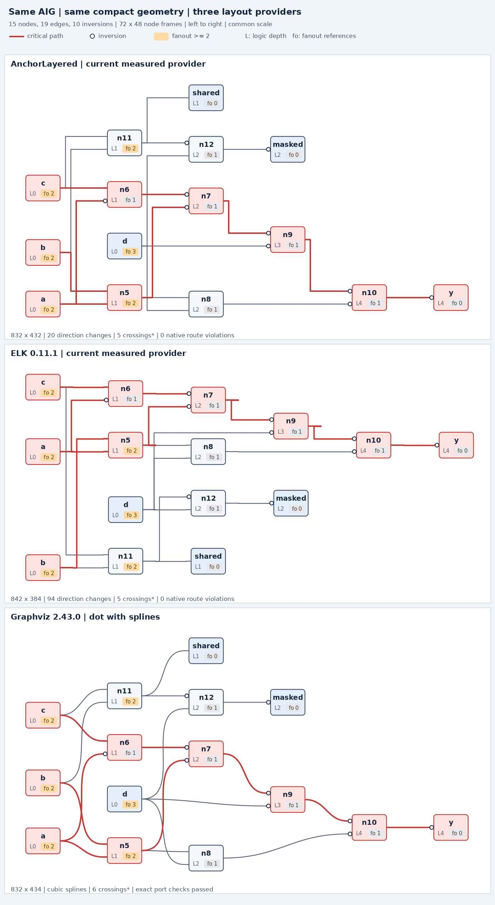

# AnchorLayered ELK 与 Graphviz 的同 AIG 实跑对比

实验日期：2026-11-14。输入沿用 [shared_cone.aag](assets/aig_visualization_2026_11_14/shared_cone.aag)：4 个输入、8 个 AND、3 个输出、逻辑深度 4。三者使用相同的节点、连接、fanin 槽位、极性和分析结果，不执行逻辑优化。

**本轮验证现有布局器能处理紧凑 AIG，但不能据此决定 mockturtle 风格的选型。** 实验将三者统一成 LR、矩形节点、固定引脚与反相气泡，偏向现有工程原理图的显示规则。用户随后明确要求接近 mockturtle / Graphviz 的读图习惯，因此 AIG 路线建议已修正为 Graphviz dot，见 [原生风格与高亮实图](aig_mockturtle_style.md)。以下数据与图片保留，作为该组统一条件下的实测记录。

这是一轮小型 AIG 的布局与显示实验，不是大图性能排名；本轮没有更改生产布局算法、提供器默认值或 Simple。

## 统一条件

| 项目 | 三者共同设置 |
| --- | --- |
| 显示图 | 15 个节点、19 条逻辑边；不画未使用的常量 0 |
| 节点几何 | 每个节点统一为 72 × 48；符号主体 64 × 48，左侧 8 单位预留输入端反相标记 |
| 端口 | AND 的两个输入在左侧 y=12、36，输出在右侧 y=24；PO 输入在左侧中点 |
| 方向 | 从左到右 |
| 间距参数 | 同层节点间距 48，层间间距 80；这是给各引擎的间距配置，不保证算法输出完全相同的实际距离 |
| 分层 | 不额外强制 PI/PO 同层，不给 Graphviz 单独增加逻辑深度 rank 分组 |
| 标签与样式 | 同一 SVG 绘制代码、字体、线宽、颜色、反相标记和缩放比例 |
| 反相 | 10 条反相边，在目标输入端画空心圆 |
| 关键路径 | 红色节点与红色边；按单位 AND 深度计算，包含 9 个显示节点及 9 条边 |
| 扇出 | 所有节点显示 fo；引用数 ≥ 2 的 6 个节点使用橙色徽标，包含 PO 引用 |
| 图像生成 | CairoSVG 2.9.1、Pillow 12.3.0；拼图使用相同缩放比例 |

关键路径节点中包含最深输出 y，因此显示节点计数比仅统计 AIG 实体节点多 1。输入 d 的扇出为 3，但不在最长逻辑路径上；图中保持蓝色节点加橙色徽标，展示两种指标的独立含义。

AnchorLayered 和 ELK 调用当前项目的真实 `layoutMeasured` 入口，ELK 使用 vendored 0.11.1。Graphviz 2.43.0 使用 `dot`、固定尺寸 HTML 端口与 `splines=spline`；没有调用 ABC 或 mockturtle 导出器。

三者的输出几何交给同一实验绘制层；保留原始逻辑边路由，仅做 Graphviz 坐标系转换和统一取景，不修补路线、不移动节点。这个实验绘制层尚未接入生产工作区。原生产品 provider 的 wireRoutes 和校验结果另外保存在原始结果中。

## 实际图

红色为关键路径，空心圆为反相，橙色徽标为扇出至少 2；L 表示模型的逻辑深度，而不是布局器的几何列号。



为观察没有分析颜色遮盖时的线条，另提供 [纯布局对比图](assets/aig_provider_comparison_2026_11_14/comparison_plain.png)。

可放大的矢量图：[AnchorLayered](assets/aig_provider_comparison_2026_11_14/anchor.svg)、[ELK](assets/aig_provider_comparison_2026_11_14/elk.svg)、[Graphviz](assets/aig_provider_comparison_2026_11_14/graphviz.svg)。

## 测量结果

| 指标 | AnchorLayered | 当前 ELK 适配流程 | Graphviz dot |
| --- | ---: | ---: | ---: |
| 几何范围，不含取景边距 | 832 × 432 | 842 × 384 | 832 × 434 |
| 面积 | 359,424 | 323,328 | 361,088 |
| 相对 Anchor 面积 | 100% | 89.96% | 100.46% |
| 逻辑边路径总长度 | 3,072 | 3,146.50 | 2,628.99 |
| 正交转向次数 | 20 | 94 | 不适用，使用三次曲线 |
| 近似内部横穿交点 | 5 | 5 | 6 |
| 节点重叠 | 0 | 0 | 0 |
| 边穿过无关节点 | 0 | 0 | 0 |
| 端口连接误差检查 | 通过 | 通过 | 通过 |
| 项目原生正交路由校验 | 0 违规 | 0 违规 | 不适用 |

范围包含节点测量框与路由中心线，不含拼图标题、边距。路径长度逐逻辑边累加，公共线干会重复计入，不是唯一物理导线长度，也不含共同的 8 单位符号内部连接段。

交点只计不同信号之间的内部横穿，并按位置去重；Graphviz 曲线按每段 32 个采样间隔近似，端点接触、同源共享段和部分退化交叉不计入。因此它是辅助观察指标，不是严格的平面图交叉数证明。曲线不能记成“0 个折点”来与正交线比较。

项目校验器要求正交路线，没有用它给 Graphviz 曲线判错。三者另做共同的节点重叠、无关节点穿越和端口位置检查。实验只记录一次运行耗时，包含不同的启动/调度开销，不据此排名速度。

完整数据见 [results.json](assets/aig_provider_comparison_2026_11_14/results.json)。

## ELK 的 94 个转向从哪里来

同一次 ELK 调用同时保留了引擎原始 section 和项目 `MeasuredElkLayoutProvider` 的最终输出：

| 对比 | ELK 引擎原始 section | 项目端口适配后的路径 |
| --- | ---: | ---: |
| 直角转向 | 18 | 94 |
| 180 度直接回折 | 0 | 0 |
| 长度不超过 1 单位的非零线段 | 0 | 57 |

本样例 19 条边，每条适配后增加 4 个直角转向，合计增加 76 个。它们并非 ELK 内核额外规划了 76 个宏观绕路。

当前 [端口附接逻辑](../../src/layout/measured_elk_layout.js)在精确端口与原始 section 之间加入连接段。该调用的 ELK 端口尺寸为 1 × 1，原始端点与项目精确端点有小幅坐标差异。例如 e5_0 的源端原始坐标为 (85, 372.5)，精确端口为 (84, 372)；适配后经过 (108, 372)、(108, 372.5) 再接回主路由。目标端也增加附接段。

这些微小高度差与固定 24 单位 escape 规则共同形成图中可见的小折线，个别位置呈现短突出段。路由仍满足现有正交与避障校验，所以“0 违规”不代表线条已经足够简洁。这里保留了当前真实输出，没有在实验中修复适配器。

依据：[ELK 原始输入](assets/aig_provider_comparison_2026_11_14/elk_engine_input.json)、[引擎输出](assets/aig_provider_comparison_2026_11_14/elk_engine_raw.json)、[适配后几何](assets/aig_provider_comparison_2026_11_14/elk_geometry.json)、[逐边差异统计](assets/aig_provider_comparison_2026_11_14/elk_adapter_diagnostic.json)。

## 布局与高亮的阅读判断

| 关注点 | 本样例的观察 | 对选型的影响 |
| --- | --- | --- |
| 正交布局 | AnchorLayered 的路线规整，20 次转向；ELK 更紧凑，但当前适配后的细小折线干扰阅读 | 在正交显示条件下 Anchor 的结果较规整；不据此替代 mockturtle 风格选型。ELK 需区分引擎效果与端口适配 |
| 曲线布局 | Graphviz 的线条平滑，逻辑边总长度较 Anchor 短约 14.42%，但左侧仍有交叉，面积大约相同 | 可作为独立曲线风格候选；这个样例没有证明它需要取代现有布局 |
| 反相边 | 三者均能在相同目标端表达 10 个气泡，正反相混合扇出没有被改成整个源节点反相 | 主要是模型和显示层能力，不构成必须换引擎的理由 |
| 关键路径 | 三者可使用相同节点和边集合，shared/masked 分支保持非关键颜色 | 需在 AIG 分析层精确到逻辑边；颜色映射与布局解耦 |
| 扇出 | 三者均显示相同 fo，节点尺寸不随高亮变化 | 普通高亮可保持布局稳定；动态改变节点大小应作为另一种展示模式 |
| 逻辑深度 | 三者都把输入 d 放在第二个几何列，与部分 L1 节点接近；浅层输出不和 y 对齐 | 若需要严格按逻辑深度排列，必须作为额外布局目标单独比较 |

这次直接使用中性测量入口，提供了与网表 cell 默认尺寸不同的 AIG 几何，AnchorLayered 与 ELK 均完成布局。因此，可以排除“布局核心必须依赖标准单元类型，无法接受紧凑 AIG”的担心。实际接入仍需要独立 AIG 测量与 Scene，不能把实验脚本等同于生产 AIG 功能已经完成。

## 版本与复现

实验在 `mfs-remote` 的以下目录运行：

```text
/home/wzh/my_code/netlistGraphBuilder/aig_visualization_research_20261114/project_provider_comparison
```

- 当前源码快照基于 Git `59eea493d2ad947b74119771dbe7357cd54ea1b9` 加当时工作区修改，包含真实 measured provider。源码归档 SHA256 和关键文件 SHA256 在 results.json 中。
- 默认提供器记录为 `native-layered`；实验显式运行 AnchorLayered 与 ELK，没有自动降级到 Simple。
- Node v24.16.0、ELK 0.11.1、Graphviz 2.43.0。
- 公共 AAG 输入 SHA256：`99e128ede1db5ebe0785cbdd3138835ef220334e9bc3e6a39679708e77085271`。
- 深度、节点关键性、扇出逐项核对前次 aigverse 的 [分析结果](assets/aig_visualization_2026_11_14/aigverse_metrics.json)。检查模型输入未被布局改写、边身份/槽位/极性/关键性保留。

复现驱动见 [run_comparison.mjs](../../tools/research/aig_layout_comparison/run_comparison.mjs)，渲染与诊断脚本见 [render_comparison.py](../../tools/research/aig_layout_comparison/render_comparison.py)，执行方式见 [说明](../../tools/research/aig_layout_comparison/README.md)。公共输入与几何条件另存于 [common_input.json](assets/aig_provider_comparison_2026_11_14/common_input.json)，Graphviz 配置见 [graphviz.dot](assets/aig_provider_comparison_2026_11_14/graphviz.dot)。

## 本轮决定依据

在本轮显示规则下，AnchorLayered 路由校验零违规；ELK 的核心排列有紧凑度优势，但端口适配引入额外短折线；Graphviz 曲线更短，面积与 Anchor 接近。这些是样例测量结果，不足以把 AnchorLayered 推荐为 mockturtle 外观目标下的 AIG 主线。

按新的明确目标，优先采用 Graphviz dot，并保留 mockturtle 的 BT、逻辑深度分组、原生形状、样条与虚线反相约定。详见 [选型修正](aig_mockturtle_style.md)。大图、复杂结构和交互仍需继续验证；本轮没有修改生产 provider 选择。
