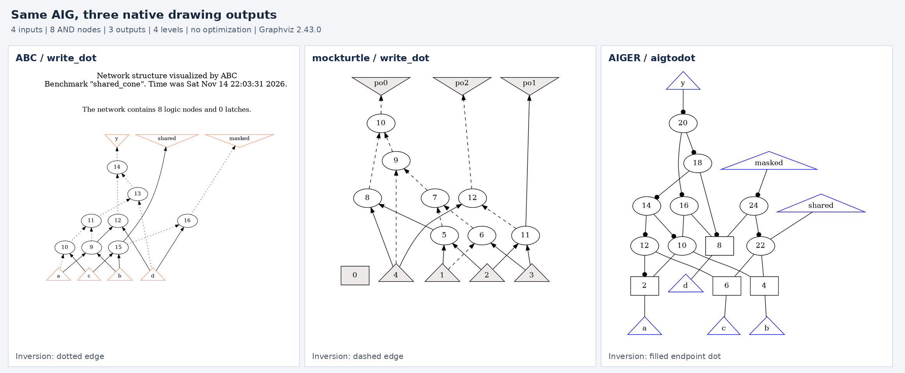
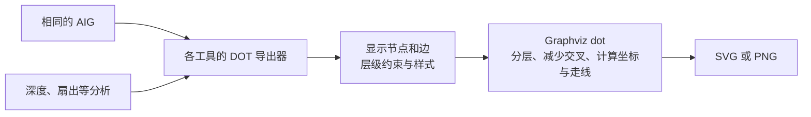
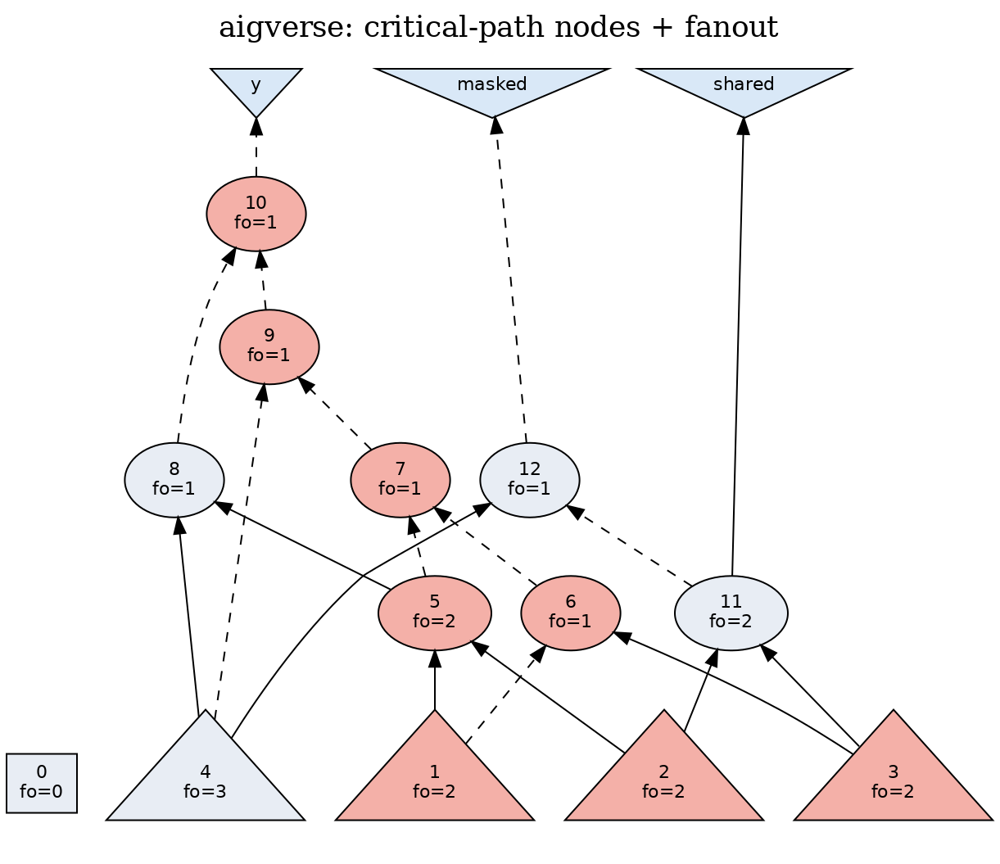

# AIG 开源绘图工具调研与同样例对比

调研与实跑日期：2026-11-14。

ABC、mockturtle 和 AIGER 的本次绘图流程都输出 DOT，再由同一个 Graphviz `dot` 计算布局、走线并生成图片。它们生成的 **显示节点、层级约束、边方向、标签和尺寸设置不同**，所以相同的 AIG 得到不同的图。反相线型、端点圆点和颜色则由导出器指定，Graphviz 不会自行理解它们的电路语义。

本样例中，mockturtle 的逻辑层级最便于阅读；ABC 保留端口名称且局部 cut 调试能力值得参考；AIGER 的反相端点标记醒目，但默认布局未统一输入、输出层。aigverse 便于通过 Python 将关键路径和扇出信息叠加到图上。

项目目标现已明确为保留 mockturtle / Graphviz 用户的读图习惯。已补充 [原生 mockturtle 风格与高亮版实图、选型修正](aig_mockturtle_style.md)：AIG 优先使用 Graphviz dot，复用现有工作台与通用渲染基础。

最新要求保留输入输出名称，支持 ABC AIG DOT 与 AND/NOT BLIF，并统一最终图。两条实际输入路径的 [带名称实图与一致性验证](aig_dot_blif_consistency.md) 已完成研究原型检查。

## 调研范围

AIG 指 And-Inverter Graph，即以二输入 AND 节点和边上的反相位表示布尔网络。本次关注直接理解 AIG/AIGER 的开源实现。netlistsvg 和 DigitalJS 面向更一般的网表原理图或数字电路仿真，不进入本轮 AIG 原生绘图对比。

ABC、mockturtle、AIGER 为同一输入实跑对象，aigverse 为分析标注实跑对象；AAG-Visualizer 保留为浏览器展示参考。这里按功能和实验效果比较，不把仓库关注度或综合工具使用量当作绘图功能的用户量排名。

## 功能与使用方式

| 工具 | AIG 绘图入口与实现 | 特色功能 | 使用边界 |
| --- | --- | --- | --- |
| ABC | C/C++ 网络表示；本次使用 `read_aiger` 和 `write_dot` | 端口命名、逻辑层级；`show_cut` 展示局部重汇聚 cut、外围逻辑锥，并突出根与 cut 边界节点 | 命令行导出适合综合调试；本次默认图不自动显示关键路径。ABC 还有其他 AIG/GIA 可视化入口，不能把不同入口的功能混为一谈 |
| mockturtle | C++ `aig_network` 和模板化 `write_dot<Ntk, Drawer>` | drawer 可定制标签、形状、填色、层级、边样式和边的可见性；`gate_dot_drawer` 可按门类型标注与着色 | 基础 drawer 使用编号；开发者需要编写调用代码或自定义 drawer；本身不是交互式图形编辑器 |
| AIGER | C 库及 `aigtodot`，直接读取 ASCII 或二进制 AIGER | 端口符号名；锁存器当前/下一状态；bad-state 属性、约束的区分显示；`-i` 改用变量索引，`-s` 隐藏符号名 | 转换器精简；没有内置关键路径、扇出高亮或交互探索；不能由 bad/constraint 的支持推断其绘出所有 AIGER 属性类型 |
| aigverse | Python AIG 接口；DOT 导出调用 mockturtle，另有 NetworkX adapter | `DepthAig.is_on_critical_path`、`FanoutAig.fanout_size`；可据此着色、改变节点大小；可分别绘制优化前后的图 | 高亮通过分析接口与绘图代码组合；pyvis/ipycytoscape 的拖动、缩放、悬浮信息需另外接入 |
| AAG-Visualizer | 浏览器读取 `.aag`，使用 Viz.js 的 Graphviz 能力 | 文件上传与浏览器展示，可作为前端接入参考 | 未纳入本次同输入三工具实验；不将其表现列为实测排名 |

实现依据：[ABC 全图导出](https://github.com/berkeley-abc/abc/blob/d527cfab4ad731b767ea0a2be2021d920d3afece/src/base/io/ioWriteDot.c)、[ABC 局部 cut 展示](https://github.com/berkeley-abc/abc/blob/d527cfab4ad731b767ea0a2be2021d920d3afece/src/base/abc/abcShow.c)、[mockturtle drawer](https://github.com/lsils/mockturtle/blob/a3f817de4005ee6ae12b4dd1ffcf4a4f910691d7/include/mockturtle/io/write_dot.hpp)、[AIGER 转换器](https://github.com/arminbiere/aiger/blob/master/aigtodot.c)、[aigverse 可视化文档](https://aigverse.readthedocs.io/en/stable/visualization.html)、[aigverse DOT 绑定](https://github.com/marcelwa/aigverse/blob/main/src/aigverse/io/write_dot.cpp)、[AAG-Visualizer](https://github.com/ByronHsu/AAG-Visualizer/blob/master/README.md)。

## 同一个 AIG 的实际输出

### 样例与一致性

输入为 [shared_cone.aag](assets/aig_visualization_2026_11_14/shared_cone.aag)，三条流程实际读取相同的 [shared_cone.aig](assets/aig_visualization_2026_11_14/shared_cone.aig)。

- 4 个输入 `a/b/c/d`，8 个 AND，3 个输出 `y/shared/masked`，最大逻辑深度为 4。
- 包含共享扇出、重汇聚、跨层连边、内部反相和输出反相；三个输出的逻辑深度分别为 4、1、2。
- 不运行优化。原始 AAG、公共二进制输入、ABC 导出回读文件、mockturtle 导出回读文件的结构指纹一致，全部 16 组输入的真值表一致。
- 所有原生 DOT 保持不变，统一由 Graphviz 2.43.0 按 144 DPI 渲染。拼图使用同一个缩放比例，没有单独放大某一工具的主体。
- 图中节点编号属于各自内部编号体系，不能直接跨工具按编号匹配。mockturtle 图中的 `1/2/3/4` 对应 `a/b/c/d`，`po0/po1/po2` 对应 `y/shared/masked`。

完整输入哈希、结构与真值表检查、源版本和图尺寸记录在 [manifest.json](assets/aig_visualization_2026_11_14/manifest.json)。这是小型组合 AIG 的阅读效果对比，不用于推断大图性能、顺序电路兼容性或所有异常输入的行为。

### 并排图与阅读效果



| 维度 | ABC write_dot | mockturtle write_dot | AIGER aigtodot |
| --- | --- | --- | --- |
| 输入与输出位置 | 输入同层、输出同层 | 输入同层、输出同层 | 未强制各输入同层或各输出同层；浅层输出留在中间 |
| 内部节点层级 | 显式逻辑层级与不可见层级链 | `depth_view` 层级与 `rank=same` 分组 | 由 DOT 边关系交给 `dot` 分层，无显式逻辑层分组 |
| 反相表达 | 点线 `dotted` | 虚线 `dashed` | 信号源端的实心圆点 `arrowhead=dot` |
| 普通边 | 实线，带信号方向箭头 | 实线，带信号方向箭头 | 实线，无箭头标记 |
| 标签 | 保留端口名；内部为 ABC 编号 | 默认节点编号与 `poN` | 保留端口名；内部默认使用去掉极性位的偶数 literal |
| 额外显示对象 | 标题、统计文字、层级辅助节点 | 未使用的常量 0 也画出 | 每个输入分为变量框与名称三角形 |
| 本样例的阅读判断 | 命名易辨认；标题占幅、整体缩小后点线偏弱 | 逻辑层次最清楚；需要补命名来表达信号含义 | 极性端点醒目；端口位置分散、输入多一段连接 |

原始矢量图：[ABC](assets/aig_visualization_2026_11_14/abc.svg)、[mockturtle](assets/aig_visualization_2026_11_14/mockturtle.svg)、[AIGER](assets/aig_visualization_2026_11_14/aiger.svg)。

## Graphviz 相同而图不同的机制

### AIG 导出与几何布局的分工



DOT 是描述图及其属性的文本格式。Graphviz 是工具集，`dot` 是其中面向有向图的分层布局引擎；它依据输入约束安排层次，并尝试减少边交叉和边长。因此，“使用 Graphviz”仍需明确采用哪个引擎。本次三者使用的是同一版本的 `dot`。[Graphviz dot 文档](https://graphviz.org/docs/layouts/dot/)

本次的 `write_dot`/`aigtodot` 调用只生成 DOT 文件，随后统一执行外部 `dot` 命令。它们没有在导出的 DOT 中给出最终 `pos` 坐标。ABC 的其他展示命令可继续调用查看流程；aigverse 还可走 NetworkX/Matplotlib 路线，不能概括成这些工具的所有可视化能力都必须使用 Graphviz。

### 交给布局器的显示图不同

**电路结构相同，不等于显示图相同。** 原始 AIG 的 4 个输入、8 个 AND、3 个输出一共对应 15 个基本显示实体，但导出器还可添加用于展示和排版的对象。

| 本次导出 | DOT 节点构成 | 对布局的影响 |
| --- | --- | --- |
| ABC | 15 个电路节点，加 8 个层级辅助节点和 2 个标题节点，共 25 个节点 | 不可见节点/边仍可参与布局；标题也需要占据空间 |
| mockturtle | 15 个电路节点，加常量节点 0，共 16 个节点 | 即使常量没有连接，仍在底层占据位置 |
| AIGER | 15 个基本实体之外，每个输入再拆出一个名字三角形，共 19 个节点 | 输入增加一段连接和可用层次；Graphviz 需要为框、名称和连线一起安排位置 |

这些是对保存的 [ABC DOT](assets/aig_visualization_2026_11_14/abc.dot)、[mockturtle DOT](assets/aig_visualization_2026_11_14/mockturtle.dot)、[AIGER DOT](assets/aig_visualization_2026_11_14/aiger.dot) 的逐项统计，不是原始 AIG 的 AND 数量变化。

### 层级约束不同

ABC 写入不可见的层级链，再将每层电路节点绑定到对应的 `LevelN`。它还在标题、输出之间增加不可见连接。以下为原始 DOT 的节选：

```dot
edge [dir = back];
{
  node [shape = plaintext];
  edge [style = invis];
  LevelTitle1 -> LevelTitle2 -> Level5 -> Level4 -> Level3 -> Level2 -> Level1 -> Level0;
}
{
  rank = same;
  Level4;
  Node13 [label = "14\n", shape = ellipse];
}
Node5 -> Node6 [style = invis];
Node6 -> Node7 [style = invis];
```

`style=invis` 只隐藏绘制；它不等同于删除这条边，也不等同于 `constraint=false`。层级链可继续约束上下层关系，同层的辅助连接还会影响排布。[Graphviz style](https://graphviz.org/docs/attrs/style/)、[Graphviz constraint](https://graphviz.org/docs/attrs/constraint/)

mockturtle 先由 `depth_view` 计算逻辑深度，再将同层节点放入 `rank=same` 分组，并把全部 PO 放入一个同层分组：

```dot
rankdir=BT;
{rank = same; 0; 1; 2; 3; 4; }
{rank = same; 5; 6; 11; }
{rank = same; 7; 8; 12; }
{rank = same; 9; }
{rank = same; 10; }
{rank = same; po0; po1; po2; }
```

`rank=same` 约束一组节点处在同一层，但不指定每个节点的精确横坐标，也不保证按声明顺序从左到右显示。因此，本样例输出实际显示为 `po0/po2/po1`。[Graphviz rank](https://graphviz.org/docs/attrs/rank/)

AIGER 的原始 DOT 没有这些同层分组，也没有层级辅助链。它提供边关系后由 `dot` 安排层次，所以 `shared`、`masked` 不必和最深的 `y` 对齐，输入 `d` 也不必与其余输入处在同一行。

### 布局用的边方向与画出的箭头不同

| 导出器 | DOT 中边的方向 | 图的布局方向 | 箭头或端点标记 |
| --- | --- | --- | --- |
| ABC | 消费者指向 fanin | 未设置 `rankdir`，采用默认 `TB` | `dir=back` 将箭头画在边的另一端，显示信号向上流动 |
| mockturtle | fanin 指向消费者 | 显式 `rankdir=BT` | 默认正向箭头，显示信号向上流动 |
| AIGER | 消费者指向 fanin | 默认 `TB` | 同相边 `arrowhead=none`；反相边 `arrowhead=dot` |

`rankdir` 规定布局朝向；`dir` 规定在哪一端绘制箭头。这是两个不同的属性。ABC 的 `dir=back` 没有把 DOT 中 `consumer -> fanin` 的关系反写成 `fanin -> consumer`。[Graphviz rankdir](https://graphviz.org/docs/attrs/rankdir/)、[Graphviz dir](https://graphviz.org/docs/attrs/dir/)

AIGER 中的实际例子：

```dot
"12" -> "2" [arrowhead=dot];
O0 -> "20" [arrowhead=dot];
```

第一条表示 literal 12 对应的 AND 使用输入 literal 2 的反相信号；第二条表示输出使用 literal 20 的反相信号。圆点位于 DOT 的 head，也就是这些边所指向的信号源端。它不是 Graphviz 自动添加的 NOT 门节点，也不是通常画在消费者输入端的空心反相泡。

### 字体与尺寸也进入几何计算

ABC 的 DOT 含有 `size = "7.5,10"`，还将长标题作为普通 `plaintext` 节点加入图中。标题扩大整体边界，超过指定尺寸后 Graphviz 按比例缩小整图；这解释了对比图中 ABC 电路主体较小的现象。统一 DPI 并不会取消各 DOT 自带的 `size` 约束。[Graphviz size](https://graphviz.org/docs/attrs/size/)

节点标签长度、字体、三角形/椭圆/矩形以及额外标题会改变需要预留的空间，进而影响横向间距、走线和图的宽高。本次保留这些默认设置，以比较工具开箱导出的实际效果。

### 反相样式与分析高亮的来源

`dotted`、`dashed`、`arrowhead=dot` 是导出器根据 complemented bit 写入的绘图属性。点线与虚线的区别主要是绘制样式，不是本次大幅层级差异的原因；端点圆点还会影响边端点的装饰和裁剪。Graphviz 只按属性绘制，不知道某条虚线意味着电路取反。

关键路径和扇出也来自 AIG 分析层。只改节点颜色通常不需要改变几何布局；如果用节点大小表示扇出，节点占用空间随之变化，就可能影响重新布局的结果。

## aigverse 关键路径与扇出实跑

同一份 AIG 通过 `DepthAig.is_on_critical_path(node)` 和 `FanoutAig.fanout_size(node)` 获取分析结果，再由实验脚本生成带标注的 DOT。



红色表示处在最长逻辑路径上的节点；`fo=N` 表示扇出数，节点宽度随扇出增大。这里的路径按单位逻辑深度计算，不包含标准单元和连线时延，不是 STA 结果。扇出计数包含输出引用。

| 节点 | 本样例含义 | 扇出 | 是否在最长逻辑路径上 |
| --- | --- | --- | --- |
| 4 | 输入 d | 3 | 否 |
| 5 | a AND b | 2 | 是 |
| 11 | b AND c，同时连接 shared 输出 | 2 | 否 |

因此，高扇出和关键路径是不同的指标。底层数据见 [aigverse_metrics.json](assets/aig_visualization_2026_11_14/aigverse_metrics.json)，矢量图见 [aigverse_highlight.svg](assets/aig_visualization_2026_11_14/aigverse_highlight.svg)。

官方的 “Highlighting Critical Paths and Fanout” 就是将这类分析数据映射到颜色和大小。这里的附图由实验代码组合这些接口生成，不应描述成 aigverse 自带的一键 GUI 功能。[aigverse 官方示例](https://aigverse.readthedocs.io/en/stable/visualization.html)

## 版本与复现

| 项目 | 本次使用版本 |
| --- | --- |
| ABC | 1.01；源提交 `d527cfab4ad731b767ea0a2be2021d920d3afece` |
| mockturtle | 源提交 `a3f817de4005ee6ae12b4dd1ffcf4a4f910691d7` |
| AIGER | 实际 `aiger.c/aiger.h/aigtodot.c` 的 SHA256 见 manifest |
| aigverse | 0.1.7 |
| Graphviz | 2.43.0 |
| 拼图工具 | Pillow 9.0.1 |

主要命令如下，均在实验目录执行：

```sh
./abc_build/abc -c "read_aiger shared_cone.aig; print_stats; write_dot abc.dot; write_aiger abc_roundtrip.aig"
./draw_aig shared_cone.aig mockturtle.dot mockturtle_roundtrip.aig
../aigtodot shared_cone.aig aiger.dot

dot -Gdpi=144 -Tsvg abc.dot -o abc.svg
dot -Gdpi=144 -Tsvg mockturtle.dot -o mockturtle.svg
dot -Gdpi=144 -Tsvg aiger.dot -o aiger.svg
```

[DrawAig.cpp](assets/aig_visualization_2026_11_14/DrawAig.cpp) 是原生 mockturtle 驱动；[generate_comparison.py](assets/aig_visualization_2026_11_14/generate_comparison.py) 保存输入准备、结构/真值表校验、三工具调用、拼图和 aigverse 标注逻辑。脚本依赖原实验目录中的可执行文件与 Python 环境，不能直接在只有图片的目录中执行。

构建与运行发生在 `mfs-remote`，目录为：

```text
/home/wzh/my_code/netlistGraphBuilder/aig_visualization_research_20261114/same_aig_comparison
```

第三方源码保留在服务器的 `/home/wzh/open_source/abc`、`/home/wzh/open_source/mockturtle` 和 `/home/wzh/open_source/aiger`。仓库文档仅保存小型结果、输入及复现驱动。

本次运行有两项兼容处理，均未改变图的拓扑或默认绘图规则：

1. ABC 源快照的 C 文件包含 `nullptr`，在隔离构建目录使用 C 编译标志 `-Dnullptr=NULL`，未修改第三方源码。
2. aigverse/mockturtle 二进制 writer 输出以裸字符 `c` 结尾，而严格 AIGER reader 要求注释分隔符为 `c\n`。生成公共输入时补上末尾换行，之后三个工具读取同一文件。

更完整的执行说明见 [README.txt](assets/aig_visualization_2026_11_14/README.txt)。

## 选型含义

结合当前代码边界的 Graphviz 与现有布局方案比较，见 [现有项目的 AIG 布局接入评估](aig_project_integration.md)，重点覆盖布局质量、边极性、关键路径和扇出高亮。

现有 AnchorLayered、ELK 与 Graphviz 使用统一紧凑几何的实际图片和测量结果，见 [三布局器同 AIG 实跑对比](aig_provider_comparison.md)。

若需要层次清楚且能定制的静态 AIG 图，mockturtle 的“深度分析加 drawer”值得优先参考。若需要围绕优化节点检查局部 cut 和逻辑锥，ABC 的局部展示更有针对性。若需要直接检查 AIGER 结构及其反相端点表达，`aigtodot` 路径最精简。若需要快速增加关键路径、扇出和其他分析标记，aigverse 的 Python 接口更方便组合。

对本项目可借鉴的是显示图构造、逻辑层约束和分析到视觉属性的映射。上述实验没有证明必须更换当前布局提供器，也不构成引入 Graphviz 运行时依赖或修改 Simple 冻结范围的决定。
